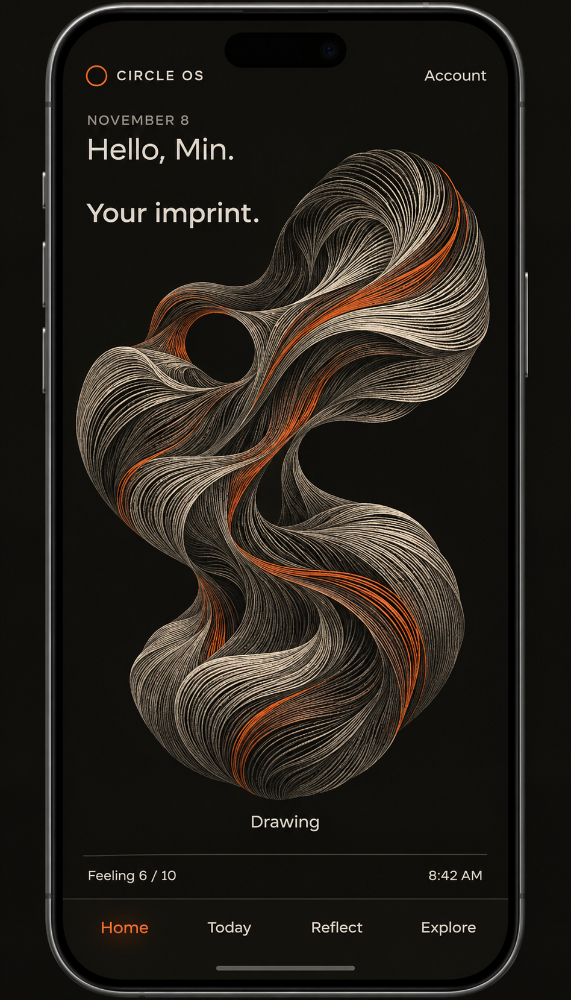
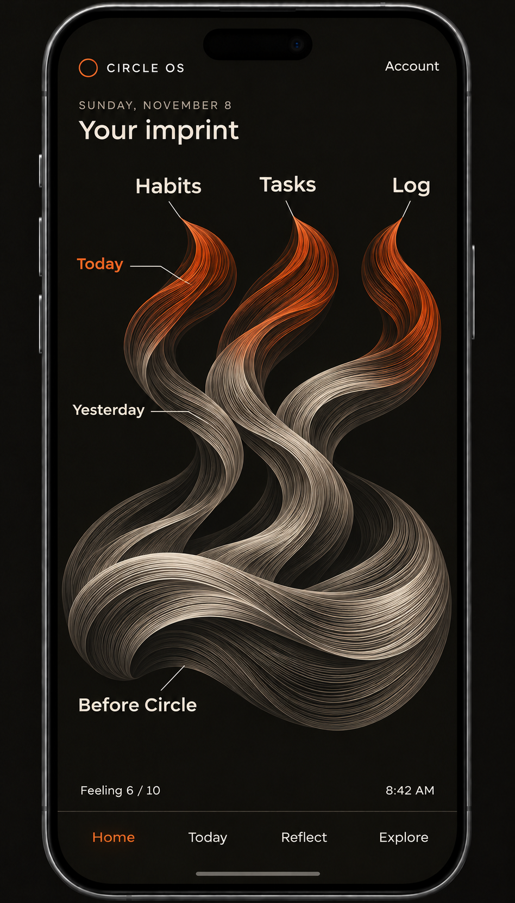
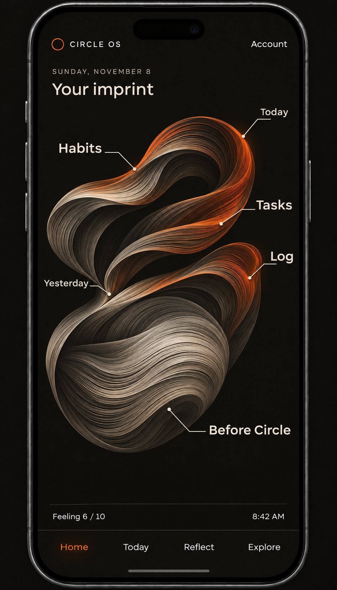

# Personal Imprint: Circle OS Home

Updated: 2026-11-11, Asia/Bangkok. Status: developer-selected Home direction;
visual/data model proposed, production rendering not implemented.

## Start here in a new chat

Home should recognize the person's starting point before Circle and the life
they continue recording. Preserve the finely engraved flowing-ribbon aesthetic.
Keep simple labelled destinations for Habits, Tasks, Log and possibly Protocol.

The four-root navigation and full-page daily tools now exist. Home itself is
intentionally empty. This brief does not imply that a source mapping, generated
imprint or tool-area navigation has been implemented.

Use the [replacement onboarding](ONBOARDING_SPEC.md), [Product](PRODUCT.md),
[record contract](PERSONAL_RECORDS_AND_ATHENA_PLAN.md), [Design](../DESIGN.md)
and [Page standard](../app/os/APP_SESSION_STANDARD.md). Exact silhouette,
fade/brightness formula and Protocol placement remain open.
Earlier concept discussion is [archived](archive/2026-11-11-doc-cleanup/PERSONAL_IMPRINT_HOME.md).

## Portable visual references

These are concept art, not working UI or real personal evidence.

## Settled direction and proposals

| Topic | Recorded direction | Status |
| --- | --- | --- |
| Home concept | Personal Imprint represents past and present. | Developer-selected direction. |
| Starting shape | Form the shape from onboarding answers, with one fold or bundle per answered question. No fold or bundle for Not sure yet. | Developer-proposed rule to preserve and explore. |
| Daily destinations | Give Habits, Tasks, and Log their own areas. | Developer direction. |
| Navigation | Tapping a tool area opens its main page. | Developer direction; routing is not built. |
| Input color | Input contributes faint Orange. | Developer-proposed behavior. Exact accepted-input and aggregation rules are open. |
| Completion color | Completion makes the relevant area brighter Orange. | Developer-proposed behavior; exact strength is open. |
| Log exception | Log brightens only once the saved record's time has passed. | Developer clarification. The working interpretation in the discussion is the block's end time. |
| Aging | Orange becomes fainter as days pass. | Developer direction; rate, window, and blending are open. |
| Protocol | Add its own area, or add Orange to Habits when Protocol is done. | Developer alternatives; no final choice. |
| Starting-area tap | Tapping the foundation could show the supplied starting answers. | Assistant proposal, not confirmed navigation. |
| Form selection | Substantial foundation with unfolding tool areas, or a living outer edge. | Two review concepts, not a final selection. |

The assistant suggested excluding account/verification/preview screens from the
fold count, grouping the fields for one repeated experience into one bundle,
giving Protocol a fourth area, and using a daily Protocol seal. These are
**recommendations, not decisions made by the developer**.

## Starting form

The developer proposed a fold/bundle for each answered onboarding question and
none for Not sure yet. Exact counting is not settled: the newer required-answer
flow still needs uncertain-answer routes. Excluding credentials/verification/
preview screens and grouping repeated-experience fields are recommendations,
not approved counting rules.

Use reported experiences, wanted change and chosen habit as distinct meanings.
No invented chronology, accomplishment, trait or progress toward an unrelated
ambition. The foundation is not a willpower/worth score. Name/birthday use,
unknown dates, corrections and removals need explicit mapping review.
Starting-area tap to a readable answer view remains proposed.

## Tool areas and daily color

Keep the areas recognizable and directly labelled. The developer simplified
away the need to create personal topic threads or tag everything before the
Home visual can work. Read the tools' existing records directly.

| Area | Proposed faint state | Proposed brighter state | Important boundary |
| --- | --- | --- | --- |
| Habits | Saved habit input. | A recorded habit completion. | Whether an unchanged recurring habit creates a fresh faint contribution each day is not decided. |
| Tasks | A saved task. | Its actual completed state. | A Week step and its Routine task are one record, not two contributions. |
| Log | A saved block whose end time is still ahead. | A saved block whose end time has been reached/passed. | Elapsed time is the visual condition; it does not create a Habit/Task completion or prove activity occurred. |
| Protocol | Possible active/draft input state. | Daily seal or completed phase, still to be chosen. | Daily sealing and finishing an entire phase are different events. |

The discussion used accepted saved input as the sensible starting point for
color, not keystrokes, untouched placeholders, previews, or incomplete drafts.
This is an implementation recommendation to confirm against each tool's save
contract. Reopening a screen or repeatedly saving the same text should not
manufacture activity.

The user has not chosen what one bright area means when several records have
different states. Options include separate colored filaments within the area or
a combined strength. Before implementation, decide whether one completion,
several completions, or all relevant items determines brightness. Do not quietly
adopt a percentage, action score, or equal weighting across unlike records.

### Log time rule

The concrete example discussed was a saved **14:00–15:00** block:

- Before 15:00, it contributes faint Orange.
- From 15:00, it can contribute brighter Orange.
- On later Circle days, that contribution becomes quieter under the chosen fade.

This interprets the developer's "saved record's time is passed" as **the block's
end time**. Keep that working rule explicit; single-time records or other time
formats need their own handling if introduced.

Derive the state from the saved attributed day, start/end range, and current time.
There is no need to add a synthetic completed flag to Log. A past block saved
late is already elapsed, but its color age should relate to its attributed day,
not be reset to today by the later save or correction. Editing the end into the
future can make its contribution faint again. Clearing/removing the record must
remove its current visual contribution under the owning data contract.

Handle blocks that cross midnight, the local 06:00 Circle-day boundary, app
background/resume, and reload. Old day/time attribution must not be silently
rewritten when the person travels. The exact timezone serialization remains an
existing broader contract to review.

### Fading and recent days

The developer wants faint Orange after input, stronger Orange after the relevant
completion/elapsed condition, and progressively fainter Orange as days pass.

No numeric opacities, fade duration, retention window, saturation ceiling, or
blending formula has been approved. Today and Yesterday should be represented;
the treatment of older app history is still open. The foundation should remain
present while recent color changes. Fading the presentation does not remove
underlying records.

Compute color from source state and dates, not from how often the app opens.
Recalculate after save, undo, correction, deletion, reload, and return from the
background. Honor the **06:00 Circle day**, rather than a midnight/UTC date slice.
Brightness is proposed to encode activity state and recency; the earlier study's
"Orange means selected thread only" rule has been superseded by this direction.

### Protocol placement remains open

The developer proposed either a fourth Protocol area or adding Orange to Habits
when a Protocol is done. The assistant recommended a fourth area because it adds
little rendering complexity and keeps the tap destination clear.

If Protocol shares Habits, review how Protocol remains directly discoverable,
whether the source is a term, daily seal, or full phase, and how to avoid duplicate
credit. Do not relabel Protocol evidence as a Habit completion. Do not add a new
completion condition, change duration choices, or reopen a sealed/past phase as
part of the Home design.

## Navigation and feeling

Confirmed target: tapping **Habits, Tasks, or Log opens that tool's main page**.
It does not open a personal-thread detail panel below the imprint. A separate
Protocol area would follow the same direct-entry principle if chosen.

Both the labelled destination and a sensible part of its visual area should be
usable with at least a 44px effective target. Provide visible focus and meaningful
accessible names. Do not make individual hairlines the only way to navigate.
Tool entry and Back must retain drafts, selected pages, current records, and
existing access gates. Visiting Home creates no completion or Athena request.

The foundation's own tap behavior remains proposed. It could open a readable
view of the starting answers, but that page, its corrections, and its return path
have not been designed or implemented.

Feeling stays separate from activity brightness in the reviewed concepts. Preserve
the newer [onboarding feeling contract](ONBOARDING_SPEC.md#preview-and-feeling-behavior):
required initial 0–10 dial answer, later Home check-ins, daily popups off by default,
and opt-in Ask me each day. The onboarding answer counts for its actual Circle
day. A low feeling must not reduce the person's recorded effort. The sample
"Feeling 6 / 10 · 8:42 AM" is fictional, not approved permanent copy or real data.

## Craft and implementation review

Preserve a substantial asymmetrical flowing foundation with fine engraved
ribbons, clean negative space, subdued Bone/Ink depth and controlled Orange.
Do not require a learned mark vocabulary, counts, percentages or a legend.
Tool areas are directly labelled; hairlines are not the only touch targets.

Choose foundation-unfolding versus living-edge composition, final silhouette,
accepted-input mapping, unknown-answer treatment, brightness aggregation,
fading window, Log end-time cases and Protocol source/placement before coding.
Review correction/deletion/undo, cross-midnight blocks, 06:00 rollover, travel,
reload/background return, accessibility and reduced preferences.

Reuse existing domain/read models and Page/navigation engines. Compute from
saved source state and attributed dates, not app visits or duplicate saves.
Do not create records or completions to support the drawing. Personal data,
schema, signup activation, sync and deployment require separate approval.
