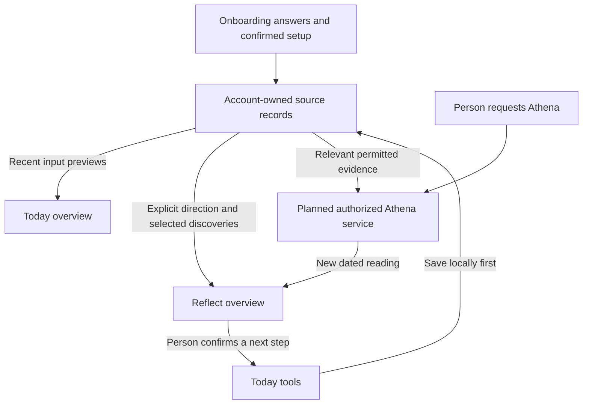

# Reflect page: potential implementation

Date: 2026-11-11, Asia/Bangkok.

Status: **saved proposal for later review; Reflect implementation is deferred**.

The developer requested saving this discussion and its concept for future work.
This authorizes preserving the proposal, not implementing its features or adopting
every suggested label, layout, record type or action as a product decision.
Application, database, personal-data, sync activation, migration and deployment
changes are outside this save. No new implementation task is started here.

## Start here when returning

Read [AGENTS.md](../AGENTS.md) and the session preflight. Then use this proposal
with [Audience and Purpose](AUDIENCE_AND_PURPOSE.md), the
[onboarding specification](ONBOARDING_SPEC.md), the
[Page standard](../app/os/APP_SESSION_STANDARD.md), and the owning Product, Design, Page, architecture
and decision documents. Review the open choices below before code.

The discussion began with a declaration-heavy proposal. After reading the
audience brief, it changed to a simpler Reflect experience. The developer then
clarified that Today may preview recent inputs and that Reflect must preview
different information. The earlier proposed "My days" activity summary is
therefore not the recommended Reflect preview.

## Audience and intended value

The primary audience in the brief is unemployed graduates in their twenties in
Myanmar who feel stuck or unsure how to move forward. The brief is based on the
founder's account and hypotheses, not verified research about every person.

Reflect should help someone discover interests, choose a direction gradually,
recognize real effort and understand what experience teaches them. They can
arrive without a purpose, goal or confident answer. Use simple English and
respect real limits such as money, safety, opportunity and family circumstances.

Starting, trying, learning that something does not suit them and returning after
an interruption may all matter. An activity is evidence of that activity, not a
score for worth or willpower. A missed day does not establish avoidance or erase
earlier effort. Encouragement must refer to actual evidence.

## Requirements and proposal boundaries

| Item | Status from this discussion |
| --- | --- |
| Today and Reflect preview different information, with taps opening full pages | Developer requirement. Avoid repetitive previews across roots. |
| Today previews recent Notes, Habit/Tasks and Log | Developer's possible direction; exact contents and composition are undecided. |
| Reflect fits the audience brief | Developer requirement. |
| Three Reflect previews: What matters to me, What I'm learning, Athena's reading | Assistant recommendation, saved as a potential implementation. |
| User-authored direction/discoveries; clearly separate Athena interpretation | Recommended source contract, explained in the discussion; still a proposal. |
| Keep in Reflect action, direct discovery writing, preview selection rules | Proposed new features requiring their own review. |
| Visible Character and Six-month pages and the Explore your direction entry | Possible deeper design, not adopted or implemented by this save. |

## Place in the overall experience

| Destination | Person's question | Proposed preview responsibility |
| --- | --- | --- |
| Home | Where am I in my life? | Personal Imprint and feeling check-in under their separate proposed contracts. |
| Today | What am I doing and recording? | Recent inputs and current daily activity; opens the working tools. |
| Reflect | What matters to me, and what am I learning? | Chosen direction, personal discoveries and saved Athena readings. |
| Explore | What could I explore? | Existing Chapters and Quests, preserving access, resume and review. |

Home's visual direction is recorded separately in
[Personal Imprint](PERSONAL_IMPRINT_HOME.md). Do not adopt its unresolved data
mapping or feeling interactions incidentally through Reflect work.

The roots can read the same underlying evidence for different purposes. They
must not maintain independent editable copies of an entry. Reflect may link to
a supporting Note or activity without showing another recent-input feed.

The intended loop is experience in Today, understanding in Reflect, then a
person-chosen next step when useful. Reflection does not have to end in another
commitment. Explore offers material the person may choose to try.

## Proposed Reflect overview

Use one continuous shared glass surface with three spacious, tappable sections.
Each has a short preview and opens its focused full page. Keep comfortable
mobile gutters, existing type roles, natural scrolling, stable frame behavior
and shared return/navigation engines. Avoid nested working panels.

This preserves Reflect's existing three-part meaning: wanted life, recorded
life and the space between. Athena's voice can contribute across them; the
proposal does not adopt a separate "Your life / Athena" tab split.

### What matters to me

Preview the person's current chosen direction or interest in their own words.
The planned onboarding's Wanted Change is the proposed initial source. An
uncertain answer remains uncertain rather than receiving an invented direction.

Tapping opens a direction page where they can review and deliberately update
what matters now. Versioning, clearing and correction behavior need a contract.
An onboarding answer does not automatically become a declaration, goal, Habit
or permanent identity. Notes and Routine do not silently change their direction.

Possible deeper access is labelled "Explore your direction" in the concept:

- Vision: the life worth wanting.
- Character: who the person is becoming.
- Mission: how they intend to live.
- Typical Tuesday: an ordinary day in that wanted life.
- Six months: a nearer picture between today and the larger Vision.

These retain their existing distinct meanings and dated histories. Character
remains authoritative under the product decision. Current front pages expose
Vision, Mission and Typical Tuesday; Character and Six months require a separate
visible-page review. Do not require five completed declarations to use Reflect.

### What I'm learning

Preview a discovery the person has explicitly recorded about their experience:
an interest, something that helped, a difficulty, a changed view or something
that did not suit them. Existing activity alone does not establish its meaning.

Two possible entry paths were discussed:

1. Write a reflection directly through a reviewed Reflect flow.
2. Select suitable existing saved writing with a proposed "Keep in Reflect"
   action. Reference the original entry rather than copying it into another
   notebook. Selecting writing does not request AI interpretation.

The exact path is unresolved. A selected existing sentence and a newly written
conclusion have different provenance: the former references existing writing;
the latter is a new dated reflection, with supporting links when relevant.
Reuse the account writing engine rather than inventing a second persistence
system. No discovery record kind, tag, selection model or schema is approved.

The preview rules should avoid featuring the same selected writing again as a
recent-input preview on Today. Its original tool/history remains accessible.
Whether and how this exclusion works across tools still needs review.

This gives a proposed free path without a required extra daily form: onboarding
supplies a starting direction, and existing writing can supply discoveries.
First-use/empty states can offer a simple optional question. They must not imply
that the system has discovered something about the person without evidence.

### Athena's reading

Preview an actual dated reading, clearly attributable to Athena. Tapping opens
the complete reading, its optional question and access to reading History.
Existing authored editions remain immutable and earlier editions read-only.

The planned service runs only when requested, subject to account authorization,
paid access and allowance. Saving writing, a discovery, an answer or a direction
change does not request a reading or reply. Requested readings appear when ready;
answering the optional question saves personal evidence, while asking Athena to
respond is a separate action. Received readings stay available after paid expiry.

Athena may propose connections from permitted records. Those remain labelled
interpretations; they do not silently replace the person's direction or become
self-authored discoveries. Exact confirmation and memory-control flows need
review. Existing prepared content and future live generation remain distinct.

## Example journey and source meanings

The following is fictional, not evidence about the developer or another person:

1. Onboarding: the person chooses "Find a direction."
2. Today: they record drawing and write "I enjoyed drawing today."
3. Reflect: they deliberately keep that sentence as something they learned.
4. Later: they choose "I want to explore creative work" as their direction.
5. If they choose a next action, confirmation creates or updates the appropriate
   existing Task/Habit record. Reading a suggestion creates no commitment.

The activity, personal discovery, wanted direction and Athena interpretation are
different claims. Drawing does not automatically establish an artistic identity,
career choice or progress toward an unrelated goal. A Week step and its Routine
task remain the same task, not two actions.

## Proposed data flow

"Source records" is a conceptual boundary, not a proposed single table or a copy
of all domains into CircleState. Keep the separate writing ledger, domain
records, declarations, calculations, personal reflections, inferred memory and
authored readings in their appropriate lifecycles. Preserve account ownership
and references to original source IDs/revisions.

For the planned Athena path, authenticate and check entitlement/allowance,
select relevant same-person saved evidence, exclude drafts/Trash/deleted or
invalid derived context, incorporate corrections, validate grounding, and store
the dated result. Login/payment details are outside the AI context. Opening a
page is not a generation request.

Corrections should refresh dependent current previews. Trashed writing leaves
active previews and Athena evidence; dependent interpretations need invalidation
or exclusion. Reading editions stay dated and immutable. How to qualify an old
reading after its source changes, and deletion propagation, remain open design
questions under the [records plan](PERSONAL_RECORDS_AND_ATHENA_PLAN.md).

Preserve local-first saves, exact acknowledgement before retiring queued work,
explicit clearing/deletion records, person-chosen conflicts and one profile per
account. Keep the 06:00 Circle day and original historical attribution. Review
each domain's sync and lifecycle rather than assuming writing sync covers all.

## Saved visual reference and limits

- [Standalone concept](design/reflect-page-concept.html).
- [Editable concept fragment](design/reflect-page-concept.fragment.html).

The concept uses fictional writing and illustrative full-page details. Its labels,
icon approximations, dates, History examples and spacing are discussion aids,
not approved product records or final screen specifications. Deeper direction
entries are placeholders; direct discovery writing and live AI are not wired.
It must not override the existing shared navigation or visual system.

An inline concept was prepared in this discussion. Browser rendering and
interaction verification did not complete: the default preview browser was
unavailable and the installed browser could not start successfully. Do not
claim measured geometry, accessibility conformance, successful navigation tests
or runtime acceptance from the concept. No application tests were run for this
documentation save.

Current implementation has account-bound local writing and prepared Athena
reading/history surfaces. Bounded hosted writing transport/recovery checks have
separate evidence; automatic writing-sync activation remains off. General
lifestyle sync and requested live Athena remain planned. The new onboarding,
Reflect previews and discovery selection described here are not built.

Save-time checks: 11 local links in the new proposal and added pointers resolve;
new documentation whitespace and `git diff --check` pass. The concept's inline
script passes the installed Node syntax check. The bundled visualization renderer
produced the standalone export; its host-state change listener was removed for
export, leaving only optional widget-state read/write calls. Export structure
and size checks pass. These checks do not establish rendered UI behavior.

## Choices to settle when work resumes

1. Final Today preview ownership and selection, including whether featured
   Reflect writing is omitted from recent-input previews.
2. Direction's relationship to onboarding Wanted Change and declarations;
   multiple interests, uncertainty, edits, history and empty/cleared states.
3. Whether discoveries start with direct writing, Keep in Reflect or both;
   selection granularity, labels, ordering, unpinning, correction and deletion.
4. Whether Character and Six months receive visible pages in this slice and
   where the deeper direction entry belongs.
5. Exact overview order/length, tap targets, detail pages, History, Back, reload,
   return position, empty states and offline behavior.
6. Prepared versus requested readings, honest freshness, sources, question/reply
   controls, membership/usage states and basic memory-control semantics.
7. Source correction/deletion effects on discoveries, derived context and
   qualifications attached to old readings without rewriting them.

When returning, review this proposal against the then-current app and authorities.
Prepare a bounded file-level implementation proposal and obtain approval.
Do not infer permission to change product rules, create schemas, migrate data,
activate sync, integrate AI or deploy from this saved discussion.

Future verification should cover different Today/Reflect previews over shared
sources; explicit user ownership of discoveries/direction; no generation on
save/visit; confirmation before commitments; source edits/Trash/deletion;
account isolation, reload/offline recovery, immutable histories and return paths.
Use synthetic data and the shared mobile consistency checks when touching layout
or interaction. No new runtime or geometry result is claimed here.
