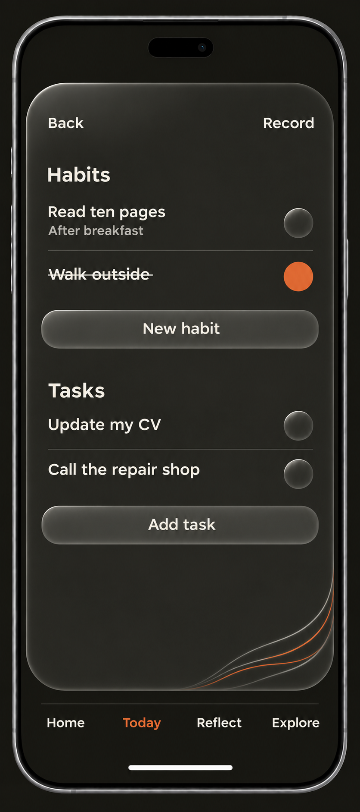
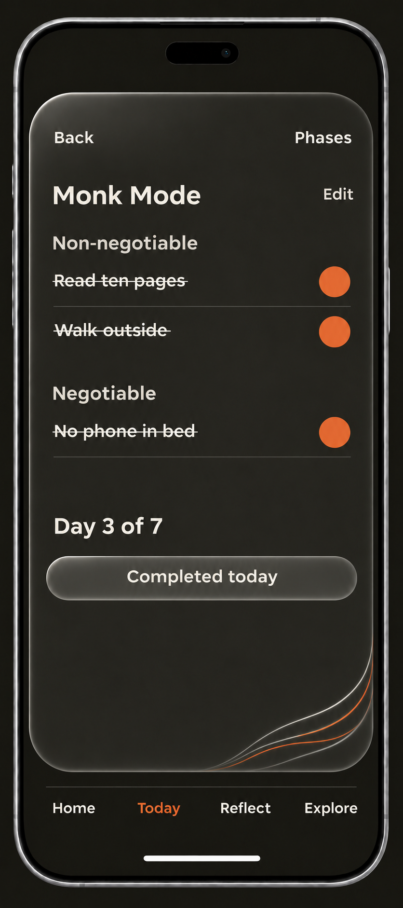
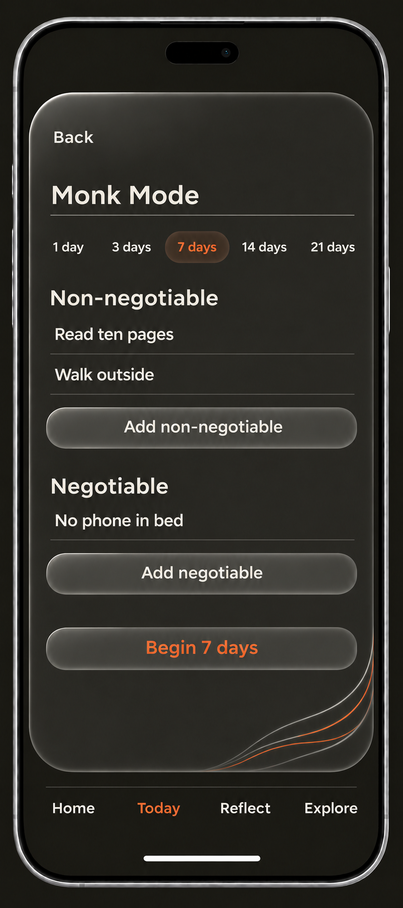
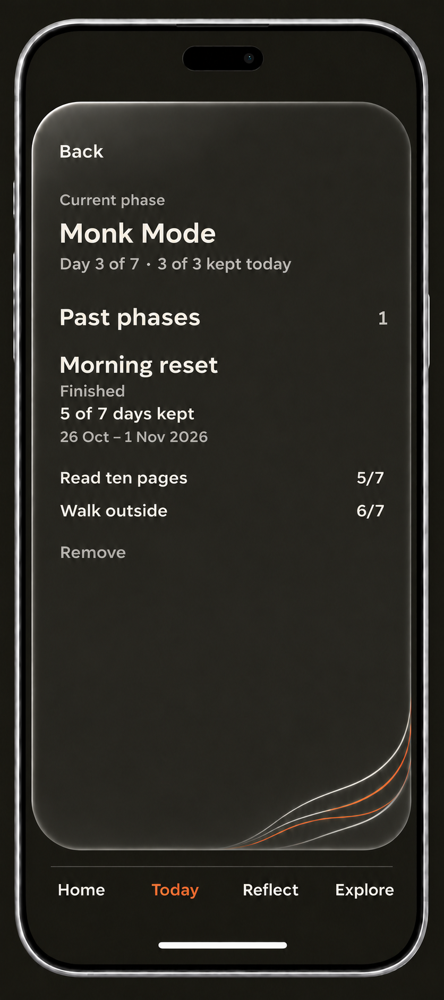

> Historical snapshot preserved on 2026-11-11 before the approved documentation cleanup.
> This records earlier decisions, proposals and verification; it is not current instruction.
> Start with the [active document map](../../../README.md#project-documents) and
> [archive index](README.md) for the current replacement.

# Circle OS page designs

## Shared consistency pass - 2026-11-11

The developer approved the [shared tool contract](DESIGN.md#shared-tool-contract---2026-11-11)
for Note, Deep Thoughts, Routine, Protocol, Log and Week, including all supporting
views. This supersedes earlier page-specific header weights, 48px gaps, Week's
checkbox-first task delay and three-second goal delay. Use shared header, Page,
swipe, action, completion and resize engines. No fresh page-specific exception
is implied by an older visual reference below. Verify the matrix and affected
journeys before treating a page change as complete.

## Log fixes and Week goal hierarchy - 2026-11-10

Log and Week use Geist at 28px headings, 18px primary/body, 16px secondary/controls and 12px metadata, with only 400/700. Main activities and goals are bold 18px; moments and steps normal 18px; hours normal 16px except bold Orange current hour. History is regular 16px, explicitly superseding the earlier bold Header rule for these two Pages. Reading/editing/placeholders share role metrics.

An empty-hour plus opens its main activity; once a main activity exists, plus adds a smaller moment. Saved main activity stays in the hour's first grid row, with moments below. Week starts with day/date/tabs; This week's goals follows. Each goal appears once with its completion control and selected-day steps below. Spacing replaces dividers; Add Step/Add Goal precede The day and the Log return cue. Linked Tasks, existing completion/Undo, dates and read-only History retain their domain behavior.

## Log and Week controls approved - 2026-11-10

Log uses bold Orange current-hour text, one top-right History action and no Now shortcut. Empty-hour prompts read Add activity only at the current hour; saved/suggested activities stay readable and all hours remain editable. Visible plus/save marks meet the 24px right anchor while retaining 44px targets.

Week has top-right History, a bottom-left Log return cue, borderless day planning and aligned step rows. Add Step appears only with an existing goal; Add Goal sits after day planning/day tabs and before The day. Both use the shared glass action dimensions. The day count says N written. Existing completion/Undo, linked tasks, dates, History and Sunday review remain.

This approved refinement supersedes the earlier History/Now header and Week
header/step-placement rules. No record model or persistence change.

Date: 2026-11-08, Asia/Bangkok.

Status: **Routine and Protocol provide the reference. Note's first adoption
slice and Deep Thoughts' writing-pair adoption are delivered for local review;
other main pages await design.**
This is the shared record for individual page designs outside Home. Add future
page decisions and their selected references here rather than starting a new
design file for each page.

## Scope and authority

### Quiet Log controls and Week checkbox trial - 2026-11-10

Approved Log refinement removes hourly rules and arrow, colors the current
hour Orange, adopts Add task-style Add hour controls and plain Orange 16px save
ticks in 44px targets. Week has a checkbox-only trial: retain existing 30px
Orange rims, Ink fill and warm Bone tick with glass reflection/8px blur and
reversible 300ms fill/tick response. Existing state/linked-task behavior and
direct restored/reduced-motion arrivals remain. Broader Week design is pending.

### Full-page Log and left Note cue - 2026-11-10

Approved adoption: Today Log entry, full-page shared glass, History/Now Header,
editable day title, existing timeline/activities/moments, and matching saved-day
and correction views. Keep Now at top right. A Week cue uses the current swipe
pair; Week's own redesign follows separately. Preserve natural timeline growth,
original dates/times and correction history. The Note cue on Deep Thoughts
moves left with its matched gap and touch target intact. See DESIGN and the
Page standard for current dimensions/engines; release gates are unchanged.

### Deep Thoughts and writing-pair cues - 2026-11-10

Developer approved the concrete adoption proposal, with these corrections:
reuse Routine/Protocol's swipe cues between Note and Deep Thoughts; keep Note's
Back, replace Deep Thoughts' left Header control with Quote, and match all
action-to-cue gaps to New habit-to-Tasks. Implemented on the existing writing
frame, Page, header-light, button, quote and persistence engines. Both writing
cues are right aligned; History/Trash retain contextual returns. Today offers
both writing entries; #thoughts preserves direct Deep Thoughts reload.

The shared layout gap is 40px, with 44px cue hit targets and a static optical
offset matching visible Geist text edges. Short Routine content follows its
Add task/cue gap, leaving spare minimum-frame space below; this replaces the
old 24px bottom inset. Deep Thoughts uses Bone, 28px full-width question, 18px
answer, 16px bold headers and 52px/12px actions. Existing records, question flow,
Quote return, drafts, local-first behavior and release gates remain.

### Full-page Note, button-only Today - 2026-11-10

Developer explicitly approved the reviewed full-page Note scope. Note now shares
Routine/Protocol's minimum and grows down for real content. Today retains only
the Note entry; the compact preview/capped inner scroll is superseded for the
opened tool, including History and Trash. Note editor Header is Back/History;
Footer keeps only New Note. The developer subsequently requested hiding Line
access while deciding how jokes/facts should work; retain their content. Other writing controls
retain their own review boundary while the shared deck keeps one full-page frame.
This is the intended structure for remaining Pages when redesigned. Today itself
still awaits its later design. See the new DESIGN and Page standard sections.

### Note adopts the Routine standard - 2026-11-10

After reviewing the Page-by-Page proposal, the developer asked to start. The
first slice is Note, before Deep Thoughts and the later tool groups; Home stays
last. Use current DESIGN.md values rather than older trials below. Note adopts
shared smoked glass, Bone writing, bold 16px headers, 52px/12px actions, 24px
anchors and the existing header-light engine. History/Trash share the family.
The single account writing frame stays glass through Line/Deep Thoughts travel;
those Pages' content still needs its own review.

Keep compact/bounded writing, silent autosave, recovery and local-first records.
Manual-only switching remains a recommendation for a separate policy slice.
Home/onboarding, global navigation and release gates are unchanged. See
[the visual authority](DESIGN.md#note-adoption---2026-11-10) and
[verification](../../USER_JOURNEY_TESTING.md#note-adopts-the-routine-visual-standard-2026-11-10).

### Habit completion and flowing reference - 2026-11-08

Approved after local review: the corner fragment follows the supplied flowing
thread reference, using twenty-four fine intertwined smooth curves with round
joins and the existing short border fades. Following the 2026-11-09 correction,
let it flow naturally behind buttons rather than avoiding controls. The reference's full Home composition,
labels and data meaning are not being added to Routine.

Completed habits display only supplied fields. Without identity this is the
action and any supplied cue; no empty-field placeholders. With identity, the
completion immediately starts a 300ms fade/4px rise alongside height changes,
with no completion pause or settling gate. Completion control
focus is separate from text editing. Undo/editing remain usable; existing
completed arrivals show identity immediately without replay. Reduced motion
removes the rise. This replaces the earlier extra-tap behavior; saved data is
unchanged. Verification is in the journey record.

### Stronger glass and edge-only fades - 2026-11-08

The next approved pass increases frame/button reflections and backdrop blur to
16px while retaining the faint Orange shadow and quiet text area. Threads stay
visible along their irregular curves. Only the final 7px at the bottom/right
frame borders fades out; long fades along the strands were rejected. These
details supersede earlier fade/material descriptions. Layout, type and actions
are unchanged. Reduced transparency still removes blur and artwork.

### Later heading and material refinement - 2026-11-08

Approved: Routine front's Header-to-Habits gap is now 24px; Habits and Tasks
are semantic h2 headings at 28px/700. Other page gaps, 24px padding, 48px
buttons and 28px visible bubbles/44px targets remain unchanged. The separately
approved material pass slightly lifts glass reflections and adds a faint
Orange shadow beneath the frame. Twelve irregular crossing strands each fade
in and out with rounded ends instead of sharing abrupt clipped endpoints.
The decoration stays peripheral and reduced transparency removes it and blur.
These are the later targets where earlier concepts/details differ.

### Approved refinement after local review - 2026-11-08

The developer approved the follow-up measured proposal. These details supersede
the first implementation's larger controls and four-strand treatment below.
Text entry stays borderless across Circle OS, including focus/new-entry states,
with a visible caret. Shared App Pages use 24px padding on every side. Headers
align their actual text. Routine/Protocol uses 28px visible bubbles in 44px tap
targets, 48px creation buttons with 18px labels, 32px between sections, 12px
before creation buttons and 12px row padding. The 48px forehead and 4px cue gap
remain. Twelve close irregular strands partly overlap at lower right; buttons
have a faint Orange shadow while Header text stays Bone for review.

Focus is removed from Record without deleting stored values. Temporary
Today/Reflect navigation is hidden in the full-page tools; new bottom navigation
is the next task. Past phases omit the days-kept sentence and repeated term
dates, retaining outcome, period, wording, compact counts and missing-wording
disclosure when required. Saved history is unchanged. Finish Routine's layout
and interactions, then restrained action feedback, before carrying the settled
details across the remaining pages. See
[verification](../../USER_JOURNEY_TESTING.md#routine-and-protocol-refinement-2026-11-08).

The developer approved saving this record, the selected Routine image, and
linked Current Task and Session Handoff entries after reviewing that four-file
scope. This is documentation and concept preservation only, not application
implementation, a release, or an update to the current design authorities.

Use this record alongside the broader [redesign specification](UI_UX_REDESIGN.md).
The decisions below are the later reviewed targets for the subjects they cover;
older proposals do not override them. Home remains in the separate
[Personal Imprint brief](PERSONAL_IMPRINT_HOME.md), with onboarding in its
[own specification](../../ONBOARDING_SPEC.md).

[AGENTS.md](../../../AGENTS.md), the [design guide](DESIGN.md), the
[Page standard](APP_SESSION_STANDARD.md), and
[brand definitions](../../../app/brand-system.ts) still govern running code. Conflicts
with the new target need explicit alignment in a bounded implementation scope.
The selected image is concept art, not a pixel-exact specification or evidence
of working interactions. Details can be refined in the real page after the
implementation scope is reviewed and approved.

## Page inventory

There are **nine main pages in this redesign, excluding Home**. Being listed
does not mean a page's layout or interactions have been designed or approved.

| Page | Purpose | Design status |
| --- | --- | --- |
| Today | Entry to the daily tools. | Not yet designed. |
| Routine | Habits and one-time Tasks together. | Visual direction selected below. |
| Protocol | Terms, daily sealing, and phases. | Active, setup and Phases directions selected below. |
| Log | Activities and moments in a day. | Approved full-page glass adoption implemented for local verification/review. |
| Week | Weekly goals, steps assigned to days, and week review. | Checkbox glass/motion trial implemented; broader Page design pending. |
| Note | Free writing. | First Routine-standard adoption delivered for local review, including History/Trash. |
| Deep Thoughts | Questions and their answers. | Note-standard full-page adoption and writing-pair cues delivered for local review. |
| Reflect | Wanted life, recorded life, and the space between, including readings. | Not yet designed. |
| Explore | Existing Chapters and Quests. | Not yet designed. |

History, Trash, saved-reading details, and chapter readers are supporting
screens to review with their owning page. They are included in the broader
work, not counted as additional main destinations. Account/settings remains
a separate drawer proposal; its exact design is pending.

## Shared decisions

### Minimal page structure

- Keep every page as minimal as its job allows: content, useful controls, and
  a clear way back. Do not add decorative controls or explanatory copy by default.
- Use one continuous App Box for the working page. Routine's Habits and Tasks
  are sections on that surface, not separate cards. Avoid nested section cards.
- The Routine concept has no Routine title, Routine/Protocol tab labels, date,
  clock, or status-bar time. The developer asked for the same restraint across
  pages. Review necessary dates on actual records/history separately; hiding
  a decorative date must not erase a record's meaning.
- Keep comfortable phone gutters, readable existing type roles, natural
  scrolling, and touch targets of at least 44px. Do not infer final measurements
  from generated phone pixels or shrink type to fit the picture.
- Show concepts in a tall, contemporary phone mockup. The phone hardware is
  presentation framing, not UI to implement.

### Manual navigation and swipe pairs

Separate full-page screens retain these manual swipe relationships:

| Pair | Relationship |
| --- | --- |
| Note / Deep Thoughts | Free writing and guided reflection. |
| Routine / Protocol | Daily habits/tasks and a chosen multi-day commitment. |
| Log / Week | Daily records and the wider week. |

**Manual switching only.** The developer explicitly replaced automatic page
turning in the redesigned experience, including facts, jokes, and quotes.
Do not use idle timers to move away from a selected page. Preserve writing,
the selected question, and return position through navigation.

The developer removed visible Routine/Protocol local labels from the concept.
Exact accessible, discoverable entry and return paths still need review;
do not restore a tab strip silently or let swipes steal text selection and
scrolling. Week has a visible entry from Today as well as its Log swipe pairing.
Keep current route compatibility and record identifiers until implementation
contracts are reviewed.

### Keep existing functions and distinctions

- Nothing is being removed from the product by this design review. Habits and
  Tasks stay together in Routine, with distinct meanings and controls.
- A Habit repeats. A Task is a one-time intention. Log records what happened
  during a day. Week holds goals and their planned steps.
- The daily Log activity writer does not create a Routine task. A Week goal
  step is linked to the same task shown in Routine on its assigned day; it is
  not a second task or a second completion. Preserve that relationship.
- Keep Note's Line content, including facts and jokes, and Deep Thoughts'
  quotes. The reviewed direction keeps them as deliberate secondary views
  from the owning writing page, outside the main horizontal swipe pair.
  Exact access labels and exits remain to be designed; return preserves the
  writing/question. No automatic switching applies to these views either.
- Preserve local-first records, account separation, drafts/recovery, histories,
  corrections, undo, immutable chapter versions/readings, and the 06:00 Circle
  day. Layout changes do not authorize new completion rules or AI requests.

## Visual language

### Circle colors and type

Use the exact existing brand palette and its shared tokens:

| Color | Value | Role in this direction |
| --- | --- | --- |
| Ink | `#191813` | Main canvas and dark foundation. |
| Bone | `#F1EFE8` | Primary text and restrained glass reflections. |
| Orange | `#E36B37` | Completion state, active navigation, and sparse thread accents. |
| Charcoal | `#403E35` | Glass structure and secondary surfaces. |

Glass may produce intermediate shades by compositing these colors. Do not add
amber environmental lighting, brown/taupe haze, gold, or unrelated accent colors.
The developer rejected the brown cast introduced in an earlier blur study and
selected the later brand-corrected version. Generated images approximate color;
the real page must use exact brand values and measured composited contrast.

Keep Geist in functional app surfaces and preserve existing role-specific type
sizes, weights, and line heights. This concept does not introduce a new font or
type scale. Cormorant Garamond stays in its existing outer editorial roles.

### Glass, buttons, and completion bubbles

- Use a single glossy, translucent smoked-glass App Box with visible but
  controlled depth, rounded optical edges, and soft Bone-derived reflections.
- Avoid both extremes reviewed earlier: bright chrome-like white flares and
  a nearly flat black slab. The glass must remain visible without overpowering
  the words. Keep the center behind text calm.
- Slightly lifting the surface and softening background detail beneath it are
  useful techniques, not permission for a foggy brown overlay. Text and controls
  above the glass stay sharp. Exact blur, opacity, highlights, and shadows are
  still implementation-review values, not numbers established by concept art.
- Creation actions are real glass buttons beneath their lists, not text links
  beside the section headings. Keep their glass smooth and clean; no thread
  decoration on the buttons.
- Completion controls are circular glass bubbles. Uncompleted bubbles are dark;
  completed bubbles are Orange with **no tick, check, dot, or other symbol inside**.
  Preserve an accessible announced completion state and visible keyboard focus.
  The concept also uses crossed-out completed text, so the visual state is not
  conveyed by color alone. Exact Habit identity/completion transitions still
  need review against current behavior.
- Reuse the existing press/completion engines where possible. A new visual
  finish does not itself authorize replacing their behavior.

### A small fragment of the Home visual

The Home image supplies art direction, not an exact Routine layout or a chart.
The developer asked for **three to five fine flowing threads**, like a small
fragment of that larger visual. The selected Routine concept uses four.

Keep that fragment only at the **bottom right of the App Box**. Use restrained
Bone and Orange strands with organic spacing and fading ends. Remove top-left
thread artwork. Do not repeat the motif on buttons, completion bubbles, or
every corner. Keep it abstract and peripheral, away from readable content.
Its exact rendering and whether it sits beneath the glass remain adjustable.
It is decoration, not personal evidence, a progress value, or a new interaction.

### Global navigation

The concept shows Home, Today, Reflect, and Explore, with Today active in Orange
and the others Bone. The final navigation icon family is deferred; text-only
navigation in this image is a review placeholder, not a decision to remove
icons from the broader target. Keep the prior no-white-selected-background
direction. Exact bottom-bar material, glow, safe areas, and visibility on
focused/keyboard-open screens need review.

## Routine - selected concept

This is the final brand-corrected concept selected by the developer on
November 8, 2026. Earlier renders in this chat are iteration evidence, not
additional implementation targets. The sample habits and tasks are fictional.

### Composition

1. One continuous glass App Box contains the working page.
2. A compact header has Back on the left and Record on the right.
3. Habits appear first, with supplied cue text below the relevant action.
   An unset cue does not appear as placeholder content or receive a strike-through.
4. New habit is a full-width glass button directly beneath the Habit list.
5. Tasks follow as their own flat list on the same surface.
6. Add task is a matching glass button directly beneath that list.
7. Circular glass completion controls align at the right of their rows.
8. A sparse four-thread fragment sits at the lower-right edge of the App Box.
9. Root navigation sits beneath the App Box. Protocol remains its manual swipe
   neighbour without a visible Routine/Protocol tab strip.

### Details still to refine

- Exact dimensions, optical alignment, gaps, corner radii, glass depth, blur,
  opacity, button press states, and thread placement at different screen sizes.
- Empty, single-row, long-title, long-list, loading, offline, and error states;
  scrolling/frame growth without reserving dead space just to match the picture.
- Record, today's undo, History, editing, habit identity, cue/identity inputs,
  draft recovery, and archive access. Their absence from this one screenshot
  does not approve removing them. The existing editable Routine focus/title
  needs a deliberate home while respecting the request to remove the route title.
- Discovering/opening Protocol without the removed local labels; accessible
  alternatives to swipe and reliable return/focus behavior.
- Keyboard visibility, safe areas, text zoom, long content, and reduced motion.
- Readable composited text/control contrast and an effective low-effect or
  solid fallback. A generated image cannot verify accessibility or performance.

## Remaining page reviews

Use these sections for future reviewed designs. No layout or visual reference
is accepted for these pages by this documentation pass.

### Protocol

The developer approved the following concepts and confirmed that Routine stays
the visual reference. Fictional words/counts in these images are not personal
evidence. The selected Phases image removes the overall totals row explicitly
rejected in this review; keep each phase's own summary, dates and term counts.

Back and Phases sit in the Header. The chosen phase name has a separate Edit
action. Non-negotiable and Negotiable terms use circular symbol-free Orange
completion states. The day counter sits with Completed today, which appears
only when the existing model allows sealing.

Setup keeps editable name/terms, 1/3/7/14/21-day choices, creation buttons beneath
each term group and the existing Begin validation. Leaving an unbegun draft
uses the existing discard path and creates no past-phase record.

The active phase is a return entry. Past phases stays folded until opened;
records remain read only, with original dates and wording intervals. Remove
keeps its existing second-press confirmation. No past-day corrections return.

### First implementation slice - 2026-11-08

The developer explicitly approved implementation in the existing shell,
Protocol component, styles, relevant tests and design/continuity records,
then clarified that the existing foundation/functions should be reused.
No replacement application, domain model, record migration or new dependency.

Today now has Routine/Protocol entry buttons. Opening them uses the same
ChapterPlayer, SwipeSession and domain actions in a viewport-height glass App
Box; Back returns to Today and preserves records. Manual swiping/arrow keys
remain, with a keyboard-focusable alternate-tool action. URL fragments retain
the opened view through reload and permit browser Back to leave the tool.
Routine's editable focus remains at Record > Focus. Habit cue/identity editing,
the existing completion-to-identity transition, Record/Undo and History remain.
An empty cue stays hidden at rest and can still be entered while editing.

The opened tools use one Page floor of `max(344px, 100dvh - 180px)` plus the
frame border. Empty/short pages agree; real rows and histories grow with the
document. The shared 48px forehead is preserved, including Routine's absent
main heading. The scoped glass/geometry/history exceptions are aligned in
[Design](DESIGN.md), [Page standard](APP_SESSION_STANDARD.md) and
[decisions](DECISION_LOG.md). Other App Boxes retain their existing rules.

The existing Today/Reflect navigation is retained and styled at the bottom
while a tool is open. The Home/Explore destinations and final icon set are
later work; this slice adds no dead placeholder navigation. Physical-phone
keyboard behavior, other browsers and formal contrast conformance still need
review. Verification and remaining limits are in
[the journey record](../../USER_JOURNEY_TESTING.md#routine-and-protocol-glass-redesign-2026-11-08).

### Today

Not yet designed. Review clear entry to all daily tools without duplicating Home.

### Log

Current adoption is recorded above. Preserve the daily timeline, moments,
original record dates, History and deliberate text corrections.

### Week

Corrected approved columns: goal cross/Add goal plus at 24px; goal wording/Add
goal label and task cross/Add step plus at 44px; task wording/Add step label at
64px. Task text is regular 18px and only goal wording is bold. Week Header is
bold 16px like Routine, with a 24px Header-to-heading gap. Day's Record has no
Open Log button; the bottom-left Log cue stays. This supersedes the action
columns, task weight and Header gap described in earlier Week entries below.

Latest indentation refinement follows Routine: tasks indent 20px, with their
clear glyphs at the start of goal wording and their wording 20px beyond it.
Add goal aligns with goal wording; Add step aligns with task wording. Use 24px
between goal groups, 8px between tasks/before add controls, and 12px from goal
to tasks. Goals/tasks use Geist 18px/700; add controls use 16px/400. Right
completion rims remain aligned. This supersedes the spacing/left-column and
task-weight details immediately below; folding, motion and retention remain.

Current compact refinement places a 4px-separated Orange arrow beside each goal
wording, common 28px goal/task circles at the right 24px anchor and Routine clear
crosses at the left 24px anchor. Tasks use 4px gaps with 12px from their goal.
Log/Week Headers share 24px insets. Checkbox response precedes Routine text fade.
Day’s Record folds over main-activity/hour rows with smaller activities below;
History folds by event day and then owning goal/tasks. Saved weeks remain
separately folded. These appearance/motion/grouping changes supersede the
corresponding presentation below; day filtering and retention still apply.

Latest approved refinement: every open goal appears on every day, folded behind
an Orange downward arrowhead beside its title. Unfolded tasks belong only to the
selected tab. Add tasks on today/future tabs without date selectors. Completed/
removed goals and tasks move to shared-record History with compact day labels;
the day record omits day/date/title fields. Empty composer/legacy blank cleanup
and text/checkbox alignment are covered in the current journey evidence. This
supersedes the earlier all-days step list and in-page completed-goal section.

The developer approved the goal-led preview and interactions on 2026-11-10,
with the tappable reverse Log cue at the bottom left. The existing full-page
glass now holds the week range, dated scrollable rail, foldable goals with
steps across days, selected-day Log record and folded completed goals. Steps
can move within their parent week while keeping the same Routine task. Current
completion/Undo, day naming, selected-day Log corrections, chosen Sunday review
and read-only Week History remain. Review/next-week/Protocol separation is a
separate proposal. See the current PRODUCT/DESIGN/Page-standard entries and
[verification](../../USER_JOURNEY_TESTING.md#week-goals-and-lived-records---2026-11-10).

### Note

Current adoption is recorded above. Preserve direct writing, silent autosave/
recovery, New Note and History/Trash/copies. Line access remains temporarily
hidden; its retained content awaits a separate placement decision.

### Deep Thoughts

Current adoption is recorded above. Preserve questions, answers, Send/corrections,
Next question, recovery, History/Trash and the existing Quote view/return.

### Reflect

The [potential Reflect implementation](../../REFLECT_PAGE_POTENTIAL_IMPLEMENTATION.md)
and its concept are saved for later review (2026-11-11); no runtime design is
adopted or implemented by that save. It proposes direction, personal discoveries
and Athena reading previews, distinct from Today's possible recent-input
previews. Source/selection and deeper-page choices remain open. Preserve wanted
life, recorded life and the space between; existing declarations and immutable
saved reading editions stay distinct.

### Explore

Not yet designed. Preserve existing Chapter/Quest access, versions, runs,
answers, and resume/review behavior.

## Before implementation

Prepare a bounded file-level proposal and obtain approval before changing code
or current authorities. Align the selected full-page/glass/manual-navigation
target with the existing solid-theme, App Box geometry, idle-rotation, and
control rules explicitly; do not quietly override them.

Verify real interactions with isolated synthetic data. Measure the relevant
Note, Thoughts/Deep Thoughts, Habit, and Protocol geometry when changing shared
type, gaps, or frame behavior; distinguish deliberately replaced full-page
geometry from unchanged compact surfaces. Verify typing/caret visibility,
completion/undo, leave/return/reload, history access, account isolation,
contrast, and phone safe areas where affected. Preserve the owner's records.

This save introduces no application behavior and claims no new runtime,
keyboard, geometry, sync, AI, performance, or release verification.
