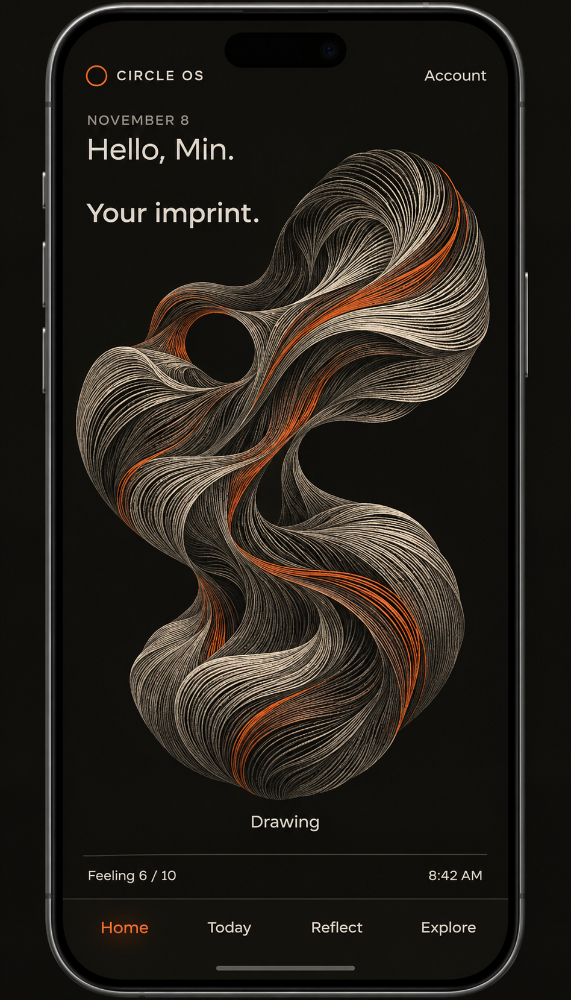
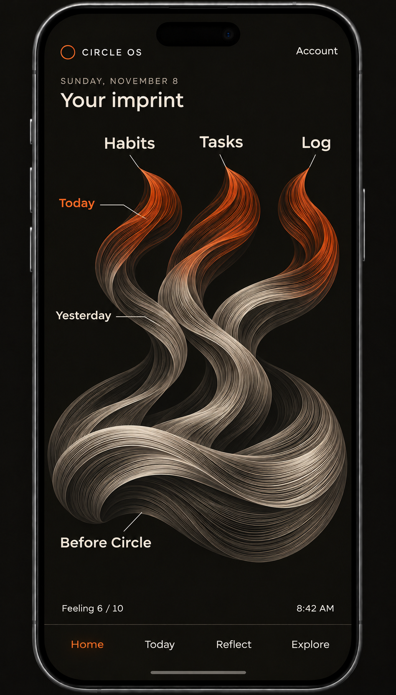
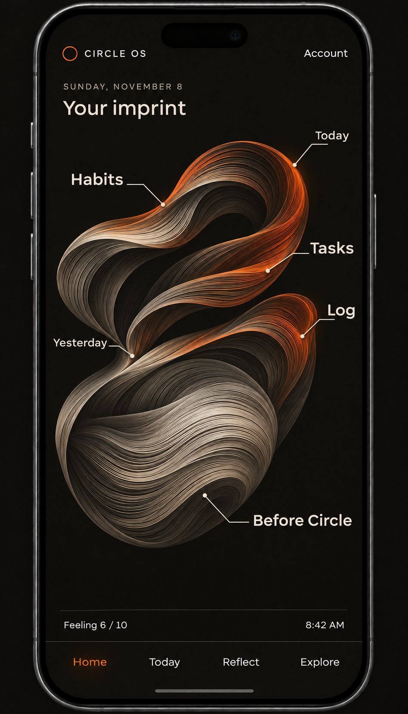

> Historical snapshot preserved on 2026-11-11 before the approved documentation cleanup.
> This records earlier decisions, proposals and verification; it is not current instruction.
> Start with the [active document map](../../../README.md#project-documents) and
> [archive index](README.md) for the current replacement.

# Personal Imprint: Circle OS Home

Date: 2026-11-08, Asia/Bangkok.

Status: **developer-selected Home direction, with a proposed visual/data model;
saved for continuation, not implemented application behavior**.

## Start here in a new chat

The developer chose **Personal Imprint** as the direction for Home. It represents
the person's starting point before Circle and the life they continue recording
through Circle. Preserve the flowing, finely engraved ribbon aesthetic in the
images below, while making the destinations simple: **Habits, Tasks, Log**, and
possibly **Protocol**.

The latest simplification supersedes earlier personal-topic ribbons, a learned
symbol vocabulary, and thread-to-record drill-down on Home. Tapping a tool area
should open that tool's main page directly. The developer has not selected the
final silhouette, fade rate, brightness formula, or Protocol placement.

This file and its three PNG references were requested explicitly for continuity.
The scope is saving the idea and pictures. It does not authorize application,
onboarding, database, personal-data, authority-document, commit, or deployment
changes. Current Task and Session Handoff are not edited by this save scope.

Read [AGENTS.md](../../../AGENTS.md) and the required session preflight before future
implementation. Use this brief alongside the [onboarding specification](../../ONBOARDING_SPEC.md),
[redesign specification](UI_UX_REDESIGN.md), and [audience brief](../../AUDIENCE_AND_PURPOSE.md).
The owning Product, Design, Page, architecture, and roadmap documents still need
explicit alignment within a reviewed implementation scope. Their older Home
requirements should not silently override this newly recorded direction, or be
silently rewritten by it.

## 1. What the person should experience

Home should feel like a personal visual object that already has a meaningful
foundation when they arrive. Their life did not begin when they installed Circle.
Their onboarding answers establish that starting form. Habits, tasks, Log, and
potentially Protocol then contribute current activity to the same imprint.

The developer wants the visual to carry more of the screen than text. Some
abstraction and art can be sacrificed for interpretation, but retain the chosen
imprint style. Avoid returning to a text dashboard with an ornamental picture.

The intended reading is ordinary and direct:

- **Starting point / Before Circle:** the foundation supplied through onboarding.
- **Habits:** the person's current habit input and completions.
- **Tasks:** saved tasks and their completion state.
- **Log:** saved time blocks, with stronger color after their recorded time passes.
- **Protocol:** an unresolved separate area or contribution within Habits.
- **Yesterday and Today:** recent contributions are visible, with older Orange
  becoming quieter as days pass.

The exact names and placement of time labels remain visual-review choices. The
images use Before Circle, Yesterday, and Today. They do not establish a calendar
scale or fabricate historical dates.

## 2. Portable visual references

All three images are exact repository copies of generated review concepts.
Their people, feeling values, times, dates, and activity content are fictional.
They establish visual direction, not measured mobile geometry or an implemented
mapping from real records to every hairline. Phone hardware is presentation only.

### Original selected style



This was the developer's favorite visual family: a single asymmetrical organic
form built from fine flowing Bone, Charcoal, and Orange strands on Ink. Preserve
its tactile, engraved quality and quiet depth. Its original Drawing label and
arbitrary Orange strands do not define the latest product behavior.

### Foundation unfolding



A substantial lower fold represents the starting foundation. Three integrated
bundles extend upward to Habits, Tasks, and Log. Bone recent material and Orange
current material suggest Yesterday and Today. The foundation remains visually
important instead of becoming a tiny seed beneath the app activity.

### Imprint with a living edge



Closer to the original flowing silhouette: an existing folded inner body remains
present while recent activity appears along its emerging edges. Tool labels are
attached around the form rather than arranged as three straight columns.

The assistant preferred this second foundation treatment for retaining the
original character. **The developer has not chosen between these two forms.**
Both images have three tool areas because Protocol placement remains unresolved.
Do not interpret its absence as a decision to exclude it.

## 3. Decision record: what is settled and what is still proposed

| Topic | Recorded direction | Status |
| --- | --- | --- |
| Home concept | Personal Imprint represents past and present. | Developer-selected direction. |
| Starting shape | Form the shape from onboarding answers, with one fold or bundle per answered question. No fold or bundle for Not sure yet. | Developer-proposed rule to preserve and explore. |
| Daily destinations | Give Habits, Tasks, and Log their own areas. | Developer direction. |
| Navigation | Tapping a tool area opens its main page. | Developer direction; routing is not built. |
| Input color | Input contributes faint Orange. | Developer-proposed behavior. Exact accepted-input and aggregation rules are open. |
| Completion color | Completion makes the relevant area brighter Orange. | Developer-proposed behavior; exact strength is open. |
| Log exception | Log brightens only once the saved record's time has passed. | Developer clarification. The working interpretation in the discussion is the block's end time. |
| Aging | Orange becomes fainter as days pass. | Developer direction; rate, window, and blending are open. |
| Protocol | Add its own area, or add Orange to Habits when Protocol is done. | Developer alternatives; no final choice. |
| Starting-area tap | Tapping the foundation could show the supplied starting answers. | Assistant proposal, not confirmed navigation. |
| Form selection | Substantial foundation with unfolding tool areas, or a living outer edge. | Two review concepts, not a final selection. |

The assistant suggested excluding account/verification/preview screens from the
fold count, grouping the fields for one repeated experience into one bundle,
giving Protocol a fourth area, and using a daily Protocol seal. These are
**recommendations, not decisions made by the developer**.

## 4. Starting form: onboarding becomes the foundation

The latest developer proposal is deliberately simple:

> One fold or bundle for every question they answered; no fold or bundle if they
> choose Not sure yet.

Preserve this proposal rather than replacing it with a hidden life score,
personality model, achievement weighting, or AI-generated interpretation.
The form can record that a substantive answer exists without judging its value.

The [onboarding flow](../../ONBOARDING_SPEC.md) includes current circumstances, reported
experiences, wanted changes, usual times, one confirmed daily habit, and an initial
feeling answer. Multiple current situations, experiences, and wanted changes are
allowed. An experience retains its supplied description and Still doing it,
Finished, or Stopped status. No experience-date question is currently included.

Important decisions before connecting the foundation to live records:

1. **Eligible questions.** The exact question-ID list has not been chosen.
   Account credentials must never become drawing input. Excluding name/birthday,
   verification, previews, and finalization from fold counting was recommended,
   but the complete personal-question list still needs review.
2. **Repeated and conditional questions.** One experience currently uses a
   category, description, and status across several screens. The developer said
   one bundle per answered question; grouping these into one experience bundle
   is an assistant suggestion. Do not silently substitute it. Decide how
   conditional follow-ups and multiple selections affect the count.
3. **Uncertain answers.** Not sure yet contributes no fold under the proposed
   rule. Nothing comes to mind yet is another discussed answer whose exact route
   and representation remain open. An actual feeling value of 0 is still an
   answer, not a missing value.
4. **Starting point versus past activity.** Some onboarding answers describe
   the present or a wanted future. They must not become invented past actions.
   If all substantive personal questions shape the foundation, Starting point
   may be a more accurate label than Before Circle. That wording is not decided.
5. **Shape stability.** A stable fold layout is recommended: returning to Home,
   saving unrelated activity, or resizing should not randomly rearrange it.
   Exact generation, seed, and correction behavior remain unchosen.
6. **Little shared information.** Fewer folds should still produce a balanced,
   usable Home. Do not fabricate answers to make the form look fuller. No fold
   for an uncertain answer does not authorize deleting that answer from records.

The foundation must not invent duration, order, completions, permanent traits,
or connections between a wanted change and an unrelated habit. A reported gym
attempt that stopped remains a real attempt with that status.

## 5. Tool areas and daily color

Keep the areas recognizable and directly labelled. The developer simplified
away the need to create personal topic threads or tag everything before the
Home visual can work. Read the tools' existing records directly.

| Area | Proposed faint state | Proposed brighter state | Important boundary |
| --- | --- | --- | --- |
| Habits | Saved habit input. | A recorded habit completion. | Whether an unchanged recurring habit creates a fresh faint contribution each day is not decided. |
| Tasks | A saved task. | Its actual completed state. | A Week step and its Routine task are one record, not two contributions. |
| Log | A saved block whose end time is still ahead. | A saved block whose end time has been reached/passed. | Elapsed time is the visual condition; it does not create a Habit/Task completion or prove activity occurred. |
| Protocol | Possible active/draft input state. | Daily seal or completed phase, still to be chosen. | Daily sealing and finishing an entire phase are different events. |

The discussion used accepted saved input as the sensible starting point for
color, not keystrokes, untouched placeholders, previews, or incomplete drafts.
This is an implementation recommendation to confirm against each tool's save
contract. Reopening a screen or repeatedly saving the same text should not
manufacture activity.

The user has not chosen what one bright area means when several records have
different states. Options include separate colored filaments within the area or
a combined strength. Before implementation, decide whether one completion,
several completions, or all relevant items determines brightness. Do not quietly
adopt a percentage, action score, or equal weighting across unlike records.

### Log time rule

The concrete example discussed was a saved **14:00–15:00** block:

- Before 15:00, it contributes faint Orange.
- From 15:00, it can contribute brighter Orange.
- On later Circle days, that contribution becomes quieter under the chosen fade.

This interprets the developer's "saved record's time is passed" as **the block's
end time**. Keep that working rule explicit; single-time records or other time
formats need their own handling if introduced.

Derive the state from the saved attributed day, start/end range, and current time.
There is no need to add a synthetic completed flag to Log. A past block saved
late is already elapsed, but its color age should relate to its attributed day,
not be reset to today by the later save or correction. Editing the end into the
future can make its contribution faint again. Clearing/removing the record must
remove its current visual contribution under the owning data contract.

Handle blocks that cross midnight, the local 06:00 Circle-day boundary, app
background/resume, and reload. Old day/time attribution must not be silently
rewritten when the person travels. The exact timezone serialization remains an
existing broader contract to review.

### Fading and recent days

The developer wants faint Orange after input, stronger Orange after the relevant
completion/elapsed condition, and progressively fainter Orange as days pass.

No numeric opacities, fade duration, retention window, saturation ceiling, or
blending formula has been approved. Today and Yesterday should be represented;
the treatment of older app history is still open. The foundation should remain
present while recent color changes. Fading the presentation does not remove
underlying records.

Compute color from source state and dates, not from how often the app opens.
Recalculate after save, undo, correction, deletion, reload, and return from the
background. Honor the **06:00 Circle day**, rather than a midnight/UTC date slice.
Brightness is proposed to encode activity state and recency; the earlier study's
"Orange means selected thread only" rule has been superseded by this direction.

### Protocol placement remains open

The developer proposed either a fourth Protocol area or adding Orange to Habits
when a Protocol is done. The assistant recommended a fourth area because it adds
little rendering complexity and keeps the tap destination clear.

If Protocol shares Habits, review how Protocol remains directly discoverable,
whether the source is a term, daily seal, or full phase, and how to avoid duplicate
credit. Do not relabel Protocol evidence as a Habit completion. Do not add a new
completion condition, change duration choices, or reopen a sealed/past phase as
part of the Home design.

## 6. Navigation and feeling

Confirmed target: tapping **Habits, Tasks, or Log opens that tool's main page**.
It does not open a personal-thread detail panel below the imprint. A separate
Protocol area would follow the same direct-entry principle if chosen.

Both the labelled destination and a sensible part of its visual area should be
usable with at least a 44px effective target. Provide visible focus and meaningful
accessible names. Do not make individual hairlines the only way to navigate.
Tool entry and Back must retain drafts, selected pages, current records, and
existing access gates. Visiting Home creates no completion or Athena request.

The foundation's own tap behavior remains proposed. It could open a readable
view of the starting answers, but that page, its corrections, and its return path
have not been designed or implemented.

Feeling stays separate from activity brightness in the reviewed concepts. Preserve
the newer [onboarding feeling contract](../../ONBOARDING_SPEC.md#preview-and-feeling-behavior):
required initial 0–10 dial answer, later Home check-ins, daily popups off by default,
and opt-in Ask me each day. The onboarding answer counts for its actual Circle
day. A low feeling must not reduce the person's recorded effort. The sample
"Feeling 6 / 10 · 8:42 AM" is fictional, not approved permanent copy or real data.

## 7. Visual reconstruction instructions

Preserve Circle's current design sources: [brand](../../../app/brand-system.ts),
[tokens](../../../app/tokens.css), [design guide](DESIGN.md), and
[Page standard](APP_SESSION_STANDARD.md). Record and resolve conflicts
explicitly before changing the running app.

- **Palette:** Ink `#191813`, Bone `#F1EFE8`, Orange `#E36B37`, Charcoal `#403E35`.
- **Type:** Geist for functional app content. Do not introduce a serif into the
  imprint labels. Preserve existing role typography during implementation.
- **Main form:** one irregular, continuous, sculptural silhouette composed of
  many close parallel curves. Think fine engraving or flowing fibre relief.
  The hairline material is the style; do not assume every hairline is a record.
- **Starting foundation:** substantial and visibly established. In the first
  variation it is a broad lower fold; in the second it is a rich inner/lower body.
- **Tool regions:** integrated, distinguishable areas with short labels. Avoid
  three unrelated cards, three straight chart columns, or a map of separate nodes.
- **Daily color:** restrained Orange within the recent tool regions, with lower
  intensity for input and higher intensity for the specified completed/elapsed
  state. Bone/Charcoal keep the older structure legible. Exact values are open.
- **Labels:** short, readable, ordinary language. Short leaders are acceptable.
  No mandatory mark legend, symbolic vocabulary, counts, percentages, or score.
- **Composition:** mobile first, normal 24px gutters as the starting point,
  one large visual focus, modest header, separate feeling entry, reserved bottom
  navigation/safe-area space. Do not derive exact type sizes from generated pixels.
- **Navigation appearance:** Home, Today, Reflect, Explore; active Orange with a
  restrained static glow, no white/Bone selected tile. The pictures use text-only
  tabs because the final navigation icon family is still deferred.
- **Motion:** calm and meaningful. Never pulse brightness to imply new evidence.
  Keep label positions and hit targets stable. Respect reduced motion.

Avoid a glowing orb, neon/gold haze, literal plants/roots, an isometric landscape,
concentric percentage rings, random motion, or a conventional statistics board.
Those were different visual explorations, not this chosen direction.

### Reusable image-direction brief

Use the repository PNGs as references. The following describes a continuation,
not a substitute for resolving the data rules above:

```text
Circle OS mobile Home, one subtle complete phone frame, front view. Exact
Ink/Bone/Orange/Charcoal palette, Geist, quiet dark material. Header CIRCLE OS,
small date, Your imprint. One large, asymmetrical continuous engraved-fibre form.
A substantial established lower/inner foundation carries the person's onboarding
starting point. Distinct but integrated regions lead to the simple labels Habits,
Tasks, Log; Protocol remains an open fourth-region choice. Recent contributions
have faint Orange for saved input, stronger Orange after actual completion;
Log strengthens only after its saved end time. Older Orange becomes quieter.
Keep Yesterday and Today understandable without a symbol legend. Tool labels
open their main pages directly. No personal-topic labels, record counts, stamps,
life scores, percentages, or inline thread-detail list. Separate quiet feeling
row above Home/Today/Reflect/Explore navigation. Active Home Orange, no white
selected tile. Preserve generous reading space and the sculptural imprint style.
Render fictional sample content only; do not invent a final data encoding from
the reference art's arbitrary strand counts or thicknesses.
```

## 8. Feasibility and connection to the existing app

Read-only source review judged the Log end-time rule straightforward and the
whole connected Home feature **moderate in size**. This is an engineering
assessment, not a measured schedule, estimate commitment, or runtime proof.

Existing foundations:

- [Circle state and models](../../../app/os/circle-os-model.js) hold habit definitions
  and dated completions, task status/timestamps, day Log blocks with start/end,
  and dated Protocol completions/seals. Reuse these sources.
- [Account-separated storage](../../../app/os/circle-os-store.ts) loads and saves the
  Circle state. Preserve ownership, local-first behavior, and clearing semantics.
- [The shell](../../../app/os/circle-os-shell.tsx) supplies CircleStateProvider,
  OSFrame, TodayExperience, and the current tool integration. Today already has
  a 30-second live clock; a Home implementation still needs its own reviewed
  refresh/shared-clock and resume behavior.
- [The current entry](../../../app/os/page.tsx) opens Today. Habits/Tasks/Log/Protocol
  are currently integrated into Today, not already independent full-page routes.
  The four-root Home shell and direct full-page entry need actual navigation work.
- The proposed [new onboarding](../../ONBOARDING_SPEC.md) is not implemented. Existing
  Day One versions, unfinished runs, completed access, and real records must stay
  intact. Do not invent answers for returning users or force a new onboarding.

A practical implementation would draw stable vector geometry, derive the areas'
colors from the same source records, and update on record changes or elapsed
time. AI, generating a raster image for every save, and a 3D engine are not
necessary. The generated PNGs are design references, not clickable backdrops.

No extra server job or persisted "Log complete" flag is required just to show
that its end time has passed. Recalculate locally while visible and on return.
This assessment does not certify existing overnight/timezone behavior for Home.

Real lifestyle cloud sync remains separate planned work. Writing sync is a
different off-by-default system. This Home concept does not activate either,
migrate personal data, or establish cross-device readiness.

## 9. Decisions to settle before a production implementation

1. Choose/refine the final foundation silhouette and eligible onboarding answers.
2. Decide per-question versus repeated-answer-group folds and uncertain answers.
3. Resolve Starting point versus Before Circle wording for mixed past/present/
   wanted-future answers; choose whether and where a foundation tap opens.
4. Choose Protocol's location and daily seal versus full-phase contribution.
5. Define saved input, per-record versus whole-area brightness, aggregation,
   fading, and the treatment of older history. Do not infer these from the PNGs.
6. Review the Home/tool route, Back, existing-user, and onboarding compatibility
   contracts. Keep the implementation bounded to the approved slice.

An appropriate next review is one working, isolated imprint with these states:

- Immediately after onboarding, with a starting foundation and no invented activity.
- Saved input, completed/undone activity, and a Log block before/after its end time.
- Yesterday and several older days, including return after the app was closed.
- A new/archived habit, a new/reopened task, and corrected/cleared Log content.
- A Protocol state under whichever placement/completion contract is chosen.
- Few answers, Not sure yet, long labels, short phones, and another account.

Future verification must cover source counts/status, end-time transition without
reload, midnight and 06:00, late entries/corrections, offline/reload, account
separation, direct tool entry/Back, 44px targets, contrast, reduced motion, and
responsive geometry. Preserve the shared App Box measurements until an explicit
full-page replacement contract is approved. Follow the workflow's required
code/test/fix/verify cycle; documentation and concept art prove no runtime behavior.

## 10. Scope and handoff boundary

This save adds this markdown file and three design references only. Existing
Product, Decision Log, Roadmap, Design, Page standard, architecture, onboarding,
redesign, Current Task, Session Handoff, application, and personal data are
unchanged by it. Earlier continuity entries that call the exact Home visual open
predate this direction; the remaining visual/data contracts above are still open.

**Next action:** use this brief and the three pictures to review the outstanding
mapping and navigation choices, then obtain approval for a concrete implementation
and owning-document alignment scope. Saving this concept is not permission to
activate public signup, sync, publish chapters, migrate data, or deploy.
