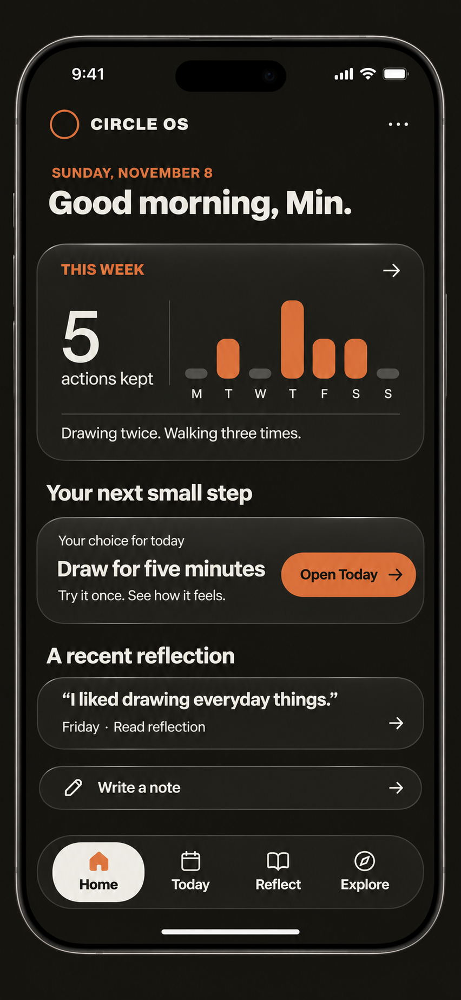

> Historical snapshot preserved on 2026-11-11 before the approved documentation cleanup.
> This records earlier decisions, proposals and verification; it is not current instruction.
> Start with the [active document map](../../../README.md#project-documents) and
> [archive index](README.md) for the current replacement.

# Circle OS UI/UX redesign specification

Date: 2026-11-08, Asia/Bangkok.

Status: **reviewed direction and proposed screen contracts; documentation only**.

## 1. Purpose, approval, and authority

This document carries the design review into a concrete reference for future
UI/UX work. The developer selected the dark Home concept below as the closest
visual direction, then clarified its navigation, icon, and data-visualization
requirements. On November 8, after choosing to keep reviewing before saving,
the developer asked to complete this markdown and move onboarding to a new chat.
That request authorizes this documentation pass, not application implementation.

The reviewed file scope is this specification, a repository copy of the selected
reference, and short linked entries in Current Task and Session Handoff. It does
not include application code, changes to current design/product authorities,
chapter publication, personal records, remote configuration, commits, or release.

The selected image is a **material and composition reference**. Its chart, count,
copy, icons, white selected-navigation background, and sample personal evidence
are not approved product requirements. Later conversation supersedes those parts.

### 1.1 How to read requirements

- **Confirmed target:** explicitly chosen in this review. Implementation still
  needs a bounded proposal and approval.
- **Preserve:** an existing product or data contract that this redesign does not
  authorize changing.
- **Proposed:** a concrete recommendation for review, not a settled decision.
- **Open/deferred:** unresolved, or intentionally assigned to another discussion.

The current [design guide](DESIGN.md), [Page standard](APP_SESSION_STANDARD.md),
[product](PRODUCT.md), [roadmap](ROADMAP.md), and [decision log](DECISION_LOG.md)
continue to govern running code. This target document does not silently replace
them. Section 15 identifies the conflicts that must be reconciled before the
affected implementation. The roadmap still owns delivery order.

## 2. Selected visual reference

Original supplied file: `D:/CircleOS/ChatGPT Image Nov 8, 2026, 09_03_11 AM.png`.
The repository copy is the portable reference. The rendered phone hardware,
status bar, keyboard, perspective, and image resolution are not application UI.
Implement actual controls and text; do not place this image behind clickable areas.

### 2.1 Confirmed target

| Element | Direction |
| --- | --- |
| Identity | Preserve Circle: Whole. Human. Alive. |
| Typography | Preserve current typefaces, type roles, sizes, and weights. |
| Palette | Preserve Bone, Ink, Orange, and Charcoal and their existing token system. |
| Background | Dark Ink, close to the current app; no brown/gold atmosphere. |
| Panels | Retain the selected image's dark, softly dimensional panels and quiet edge highlights. |
| Navigation | Cover Home, Today, Reflect, and Explore. Daily tools open as full-page screens. |
| Icons | Use interface icons only in bottom navigation. Design that icon set later. |
| Active tab | Orange icon/label with restrained Orange glow; no Bone/white selected background. Other icons stay Bone. |
| Page-opening affordance | Small solid Orange circle, without a surrounding white circle. |
| Spacing | Start from current Circle spacing. Change only where rendered review shows a problem. |
| Home direction | Prefer data visuals, with one main visual rather than four separate charts. |
| Initial Home value | Recognize ground already covered in life, using experiences the person supplies during onboarding. |
| Daily feeling | Ask when the person first opens the app for the Circle day, rather than repeatedly throughout that day. |
| Onboarding | Resolve questions and evidence contracts in a new chat. |

### 2.2 What has not been adopted

- The weekly completed-action chart and the definition of "actions kept."
- A circular activity arc or a short trail of weekly moments.
- The static "Your snapshot" diagrams: they did not communicate progress.
- Direction, interests, and daily rhythm as a scored or final Home chart.
- Mood at the center of a chart, or mood as a progress measure.
- A particular lifetime timeline, milestone layout, chart scale, or aggregation.
- Any generated writing screen as an accepted final layout.
- The experimental circle-derived navigation glyphs. The Today glyph resembled
  a power control and must not be treated as final.
- Percentages of a life completed, an overall life score, a willpower score,
  public comparison, or inferred permanent traits from a past attempt.

## 3. Audience and intended experience

The [audience brief](../../AUDIENCE_AND_PURPOSE.md) is the review's audience reference.
Its primary audience is unemployed graduates in their twenties in Myanmar who
feel stuck or unsure how to move forward. The circumstances and behavioral
patterns in that brief are founder observations and research hypotheses, not
verified claims about every intended user.

The design should help a person:

1. Recognize their starting circumstances and effort already made.
2. Discover interests through experience.
3. Choose a direction and an action within reach.
4. Record, reflect, and recognize meaningful movement over time.

No goal, enthusiasm, daily routine, or clear purpose is required at entry. Keep
needed rest, interruption, and external limits compatible with the experience.
Do not label missing records as laziness or a stopped attempt as worthless.

Use short, plain English. Recognition must point to something the person said
or recorded. Avoid automatic praise, diagnosis, or a promise of employment,
income, happiness, or escape from external circumstances.

## 4. Visual system and component treatment

### 4.1 Existing sources to reuse

- [Brand definitions](../../../app/brand-system.ts): identity and named palette.
- [Design tokens](../../../app/tokens.css): existing primitive colors, radii, spacing,
  typography, and motion.
- [App styles](../../../app/os/os-app.css): functional type roles, App geometry, and
  tactile key behavior.
- [Design guide](DESIGN.md): hierarchy and shared component rules.

Do not create a second palette or replace the type system during implementation.
Keep Geist in functional app surfaces. Cormorant Garamond remains confined to
existing outer editorial roles; it is not a new writing or dashboard font.

### 4.2 Color and material roles

| Role | Required starting point |
| --- | --- |
| Main canvas | Ink, `--c-ink`, `#191813`. |
| Deep outer foundation | Existing `--c-ink-deep` where the current shell uses it. |
| Main text on dark | Bone, `--c-bone`, `#F1EFE8`. |
| Action/identity | Orange, `--c-orange`, `#E36B37`. |
| Secondary structure | Charcoal and existing warm-neutral tokens. |
| Primary Orange button text | Ink. |
| Bone reading surface, if later accepted | Ink text; keep its role separate from selected-navigation state. |

**Proposed panel recipe:** start with the existing dark neutral-950 surface
(`--c-neutral-950`, `#24231D`), a quiet Bone-derived edge, a modest top-edge
highlight, and controlled depth. Keep the center behind text visually stable.
Match the selected reference through restraint, not thick acrylic rims or
strong backlighting. Exact border opacity, highlight, blur, and shadow are
visual-review values, not approved numbers derived from the image.

The effect must have a readable solid fallback. Large-area backdrop blur is not
a requirement. Test scrolling/rendering performance before adding it. No
animated glow, glowing orb, brown haze, metallic gold tint, or unrelated accent.

**Calculated source-color contrast, not rendered verification:** Orange on Ink
is approximately 5.44:1; Orange on neutral-950 is 4.82:1; Orange on Charcoal is
3.28:1; Bone on Orange is 2.84:1. Use the darker base for small Orange labels and
Ink on Orange buttons. Translucency/highlights require testing the actual
composited colors. Follow [WCAG text contrast](https://www.w3.org/WAI/WCAG22/Understanding/contrast-minimum.html).

### 4.3 Typography and spacing

Preserve existing role-specific type values rather than estimating sizes from
generated pixels. In particular, the current editable reading surfaces use 29px
main text and 18px supporting/body text; this does not make every Home number,
label, or read-only Page 29px. Keep each role's existing weights and line heights.

| Existing measure | Starting rule for the redesign |
| --- | --- |
| Phone gutter | 24px. |
| App Box radius | Shared `--r-box`, currently 28px, for matching panels. |
| Label-to-content anchor | Existing 48px where that Page anatomy applies. |
| Main-to-Sub gap | Existing 25px where both regions exist. |
| Body-to-Footer gap | Existing 25px. |
| Gap between App Boxes/panels | Existing 18px starting point. |
| Effective touch target | At least 44px. |
| Existing app shell | Mobile-first, current 480px maximum as the initial desktop reference. |

A full-page route is a different layout from a compact App Box. Reuse these
values where they serve the same role; do not force all old frame reservations
into a full-page editor. Adjust only after reviewing real short/long content,
small screens, keyboard space, and the measurements in section 16. Never shrink
text or silently alter shared tokens to make a generated composition fit.

### 4.4 Buttons, circles, and icon policy

- Reuse the tactile key engine: solid face, short hard leg, restrained top
  light, existing press/release behavior. A new glossy button engine is unnecessary.
- Non-navigation actions use text: Back, History, New Note, Send, Restore,
  Delete forever, and appropriate account labels. Exact header wording remains
  screen review work.
- A destination may show one small solid Orange circle at its trailing edge.
  **Proposed visible diameter:** 10-12px, subject to review. Its effective target
  is at least 44px, normally through the complete labelled destination row.
  Do not add an outer white ring, arrow glyph, or unnecessary circle container.
- Give the circle's control a destination-specific accessible name. It is not
  a checkbox, completion indicator, slider, or unlabeled mystery action.
- Keep the brand mark; a logo is not a new interface-icon system.
- Bottom-navigation icons are explicitly deferred. Generated houses, calendars,
  power-like rings, books, and orbit glyphs are not approved assets.
- Whether native checkbox/checkmark affordances count as an exception to the
  icon-only-in-navigation rule remains open. Do not remove existing completion
  controls or invent a replacement as incidental styling.

## 5. Application shell and navigation

### 5.1 Confirmed destination structure

| Destination | Intended job | Content ownership |
| --- | --- | --- |
| Home | Recognize personal ground covered and see a useful next entry. | Main visual fed by reviewed onboarding evidence; daily feeling presentation; optional entry points. Exact composition remains open. |
| Today | Do and record what the person chooses today. | Routine, tasks, Protocol, Note, Deep Thoughts, Log, and Week. |
| Reflect | Read about wanted life, recorded life, and the space between. | Existing declarations, readings, source records, and relevant history. |
| Explore | Find existing material worth reading or trying. | Chapters and Quests initially; additional experiments/templates need separate review. |

**Proposed entry:** Home is the normal signed-in landing destination after
existing required first onboarding. Returning use must not force a new chapter,
review, or setup flow. Routing/entry changes need explicit approval because
current `/os` opens Today under the direct-entry decision.

### 5.2 Persistent navigation behavior: proposed contract

- Replace duplicated global top tabs with one bottom navigation on root screens.
- Keep every destination's label visible. Selected state combines Orange
  icon/label, a restrained static Orange glow, and semantic current-page state.
  Inactive icons remain Bone. There is no Bone/white selected tile or pill.
- Keep the selected root and its scroll position during ordinary visits where
  practical. Maintain each tool's own saved/current state independently.
- Opening a record creates a clear return path to its owning list/tool and then
  its root. Browser Back must follow that visible hierarchy without losing work.
- Root changes never create, complete, submit, or discard personal evidence.
- Reserve content space for the bottom bar and device safe area. The last row,
  Footer action, and keyboard focus must remain reachable above it.
- On a focused writing screen with the keyboard open, propose moving global
  bottom navigation out of the way while retaining Back and the relevant writing
  action. It returns when the keyboard closes. This keyboard behavior needs review.
- No automatic switching between full-page tools. Preserve existing legacy
  behavior until its replacement slice and authority updates are approved.
- Deep-link URL structure is implementation review work. Preserve existing
  route compatibility, especially `/os`, `/os/mirror`, authentication, and admin.
  Do not rename stored session or record identifiers to match new labels.

## 6. Home: data meaning and presentation boundary

### 6.1 Confirmed job of the main visual

The main visual should show **ground already covered in life**, including
experiences before Circle, supplied through onboarding. The developer chose this
over making change since joining Circle the primary first-use story.

The visual must have useful source material immediately after the future
onboarding. It cannot depend entirely on weeks of app completions, and it must
not invent an earlier baseline or improvement. Home has one primary visual,
not four competing charts. Its final chart form and data contract are unresolved.

Possible source material discussed includes completed education/projects,
learning, work, responsibilities, attempts that stopped, and ongoing effort.
These are candidate examples, not an approved taxonomy, weight system, intake
form, or required achievement list.

### 6.2 Preserve meaning

- Attribute onboarding information to what the person reported. Distinguish
  self-report, recorded app behavior, and any explicitly labelled inference.
- Keep completed, tried/stopped, and ongoing experiences distinct. A month at
  the gym is a real attempt, not proof of a permanent habit or trait.
- No fabricated dates, sequence, historical scores, qualifications, or statistical
  comparisons with other graduates. Unknown dates remain unknown.
- No "life completed" percentage or overall worth/willpower score. Meaningful
  evidence may be visible without combining different experiences into one number.
- The person can be uncertain or have little they wish to share. The screen must
  remain usable without a flattering story or mandatory accomplishments.
- New daily activity may later add evidence, but its relationship to the main
  visual must be reviewed; it does not automatically become a lifetime score.
- Browsing the visual reads records. It does not replay chapter outcomes,
  create commitments, alter old answers, or invoke Athena.

### 6.3 Proposed Home composition, still subject to review

1. Compact brand/account header; date and alias greeting.
2. Daily feeling presentation, placement relative to the main visual still open.
3. One main visual showing reviewed evidence of ground covered.
4. At most a small amount of supporting context that adds meaning rather than
   restating the chart.
5. A chosen next step or a useful entry action when one exists.

The selected reference's "THIS WEEK," bar chart, "5 actions kept," next-step
wording, recent-reflection panel, and Write a note shortcut are examples of
composition, not adopted Home contents. The circular snapshot images were
rejected as not showing progress. Do not implement those rejected diagrams.

### 6.4 Daily feeling

**Confirmed:** ask how the person feels on the first app open of the Circle day,
rather than asking throughout the day. The Circle day begins at local 06:00.
The answer describes that check-in moment; it is not proof of how the whole day
went, progress, failure, or the cause of their feelings.

**Proposed interaction:** present the question inline on Home, permit Skip, and
do not prompt again after answering or skipping for that day. Display the saved
answer with its check-in time and allow deliberate correction. Exact wording,
answer choices, required/optional status, correction/history semantics, first-use
onboarding interaction, and multi-device prompt coordination need review.

Do not use a poor feeling to reduce a life-progress value. Do not infer mood from
missing writing. Keep the daily answer separate from longer-term evidence.

### 6.5 Home states to specify before implementation

| State | Required design outcome |
| --- | --- |
| First use, onboarding dependency unresolved | Do not fabricate the main chart. Review a usable limited Home and its destination before releasing it. |
| No experiences shared | Offer a respectful way to begin or use Today; no invented praise or mandatory zero-score dashboard. |
| Partial/uncertain history | Render supplied evidence and uncertainty; do not fill gaps. |
| No daily check-in yet | Show the reviewed first-open question without blocking normal app use under the proposed optional flow. |
| Answered/skipped today | Keep the question quiet according to the reviewed policy; use the actual Circle date. |
| No next action | Do not assign one or label a system suggestion "Your choice." |
| Existing chosen action | Open its owning Today tool and identify the same record; do not duplicate or complete it. |
| No writing/reading available | Collapse absent optional material; do not reserve empty panel height. |
| Offline/partial device history | Read available local records; avoid cloud-success or complete-history claims. |
| Source corrected/deleted | Refresh dependent current presentation and exclude deleted/Trash material; preserve immutable original publications according to their contracts. |

### 6.6 A weekly view is not silently decided

Completed tasks/habits, Protocol terms, and a total called "actions kept" were
discussed but not chosen. If a later weekly view is reviewed:

- Decide sources, units, deduplication, missing/future-day states, and date
  attribution before choosing a chart or budget.
- A Week goal step and its Routine task are the same task; count once.
- Protocol needs separate semantic review; a seal and its individual terms are
  not automatically interchangeable count units.
- Historical habit completions survive definition archiving/renaming. Current
  active-definition summaries are not a safe lifetime-history substitute.
- Undo/reopen must update the current count without duplicated completion events.
- Use Circle dates, not a UTC string slice. A lived Monday-Sunday view is
  distinct from Week's Sunday-20:00 planning rollover.
- English keyword matching must not be assumed to recognize Burmese activities.

These safeguards do not adopt a weekly chart for Home.

## 7. Today and full-page tools

### 7.1 Today root: proposed contract

Show the current Circle date and usable access to the existing daily tools.
Preserve a clear distinction between a repeating habit, a one-time task, a
Protocol, and a goal. Do not create one catch-all record type named "action."

The exact root layout and local navigation are open. A single row of Routine,
Note, Deep Thoughts, and Log tabs was a generated example, not an approved
narrow-phone layout. All existing tools, including Week and Protocol, need a
visible route; their only discovery mechanism must not be an unexplained swipe.

Open a tool into the available page rather than a nested compact working panel.
Reuse existing model actions, saved state, editing, history, button, gesture, and
return engines. Keep swipe shortcuts only where they remain understandable and
do not steal selection, scrolling, or keyboard gestures.

### 7.2 Routine, tasks, and goals

- Keep named habits and open tasks readable. Preserve existing creation,
  completion, undo, edit, draft recovery, history, and archive semantics.
- Habit action is required before activation; cue and identity retain their
  existing optional/editable relationships. An empty cue is not habit content
  and must not be displayed or struck through as completed evidence.
- Keep today's completion controls separate from read-only dated history.
- Preserve shared goal-step/task identity and scheduled-step visibility. Do not
  complete goals automatically because every step was completed, or require every
  step before goal completion, without a separate product decision.
- Allow long lists to use the natural full-page scroll. Avoid a second short
  inner scrolling panel competing with the page.
- Exact placement of New habit, Add task, Record, and History needs screen review.
  Keep their purposes distinct rather than renaming all of them for consistency.

### 7.3 Protocol

- Full-page access must preserve draft, active, sealed-today, finished, ended,
  and past-phase states, including deliberate draft exit and end confirmation.
- Preserve 1, 3, 7, 14, and 21-day choices. Do not adopt new lengths or change a
  running duration as a visual refinement.
- Keep agreed terms and prospective wording changes. Changes take effect from
  the next Circle day where the current model requires it; history retains the
  terms that applied at the time.
- Preserve seal meaning and read-only finished phases. Do not add past-phase
  correction controls or reopen a sealed record through navigation.
- New ready-made Protocols, gentler terminology, rest rules, and interruption
  treatment are separate content/product reviews, not accepted by a new layout.

### 7.4 Log and Week

- Keep real time blocks/moments and their original dates. A blank hour is not
  evidence of inactivity. Corrections retain actual correction time.
- Preserve the continuous timeline, accessible time-entry behavior, history, and
  current text-correction boundaries. Avoid competing page and inner scrolls.
- Week stays visibly reachable from Today. Its final placement is open.
- Keep Monday-Sunday lived records distinct from Sunday-evening planning.
- Preserve manual Week setup/review entry, existing access gates, linked goals
  and tasks, and read-only completed Week history.
- Do not revive disabled Dreamline or The Four surfaces through new navigation.

## 8. Writing surfaces

### 8.1 Review status

The developer requested writing-surface examples. Dark full-page Note and Deep
Thoughts concepts were generated, including a keyboard-open example. They have
**not been accepted as final**. Their sparse appearance, header stack, text
spacing, New Note placement, and keyboard behavior remain review items.

**Proposed direction:** use a stable, quiet writing background; retain the
selected panel finish on surrounding chrome rather than placing text over
moving reflections. Start with Ink and Bone text for the dark study. A Bone
writing surface remains a review option, not a confirmed change.

### 8.2 Note: behavior to preserve

- Keep title and body as directly editable text, using current role typography.
- Preserve silent local autosave after the existing pause and on leaving, plus
  internal recovery. Keep actual failures visible and the text recoverable.
- No routine Saved/Synced/Draft banners or new Save/Discard controls.
- New Note saves current content successfully before opening another entry.
  An untouched blank composer creates no saved Note; clearing an existing Note
  remains a dated empty correction rather than deletion.
- Preserve direct History, dated rows, correction, Trash, Restore, confirmed
  Delete forever, conditional Sync, and retained Saved copies.
- Saved content, recovery text, revisions, cloud status, and retained conflict
  histories keep their current distinct meanings.
- New full-page access must leave the existing Line/Quote content reachable
  through a reviewed labelled path; it must not turn placeholders into writing.

### 8.3 Deep Thoughts and reading answers

- Preserve the actual question/source and answer relationship.
- New Deep Thoughts uses Send; accepted writing stays visible, Next question
  advances deliberately, and corrections use Save changes under the current flow.
- Recover unfinished text quietly; keep draft text outside saved evidence and
  Athena until committed. Do not restore the retired ordinary Thoughts composer.
- Sending an answer saves evidence. It is not an implicit request for AI.
- Preserve historical Thoughts, managed quotes, and source links. Entering a
  quote does not advance the question or submit its draft.
- Embedded reading answers retain their owning edition/question relationships;
  do not turn them into unrelated Notes during the layout migration.

### 8.4 Focus, scrolling, and keyboard acceptance

- The insertion point and current typed line remain visible above the keyboard.
  New lines, ordinary typing, selection, corrections, and long paragraphs must
  not jump back to the title.
- Use one understandable scrolling owner in each full-page editing state.
  Review keyboard height, viewport resize, and safe areas using real devices.
- Back and root navigation preserve accepted/recoverable work. A failed save
  must not be followed by a destructive blank editor.
- Do not reproduce the generated examples' tall header stack if it consumes
  needed writing space. Reuse current spacing first, then measure and review.
- A sticky action or navigation bar cannot cover focus or the final content.
  See [focus not obscured](https://www.w3.org/WAI/WCAG22/Understanding/focus-not-obscured-minimum.html).
- Exact keyboard-open navigation visibility and action placement remain proposed.

## 9. Reflect

**Preserve the product structure:** wanted life, recorded life, and the space
between. Athena's voice runs through them. A generated "Your life / Athena"
tab split is not an adopted replacement for that structure.

Proposed screen contract:

- Root gives readable access to the existing declaration and reading surfaces,
  including their history. Avoid requiring a complete life plan to enter.
- Vision, Character, Mission, Typical Tuesday, Six months, Routine identity,
  habit identity, and Dreamline retain their distinct meanings. Character remains
  authoritative; adding its new front Page or Six months needs a separate review.
- A new generic "direction" card must not silently replace these records or
  store an answer as a declaration without confirmation.
- Reading detail opens saved prose. Older editions stay dated and read-only;
  missing sections are not filled with today's derived observations.
- Relevant original writing/actions remain reachable from a reviewed source path.
  A quoted personal excerpt shows actual words and opens the owning record.
- Keep current prepared-content display distinct from future requested live
  Athena. No "learning" or "preparing" claim without the corresponding real state.
- Future readings/replies require an explicit request. Saving a reflection or
  answer alone makes no request. Preserve existing reading access after paid
  expiry under the product contract.
- Memory controls, provider integration, limits, corrections, and feedback remain
  their own planned work. A visual button does not certify those capabilities.

Exact Reflect composition, reading navigation, and the location of new feeling
history require review. Do not introduce another independent history store.

## 10. Explore and chapters

Proposed initial Explore scope is the existing Chapter and Quest catalogue.
Moving access must preserve chapter IDs/versions, started runs, answers,
completion/access gates, publication destinations, and historical review.

- Display a readable title, actual description, and useful entry action.
  Catalogue duration estimates and descriptions need a content audit; do not
  copy stale promises or present disabled Dreamline as an available tool.
- Continue opens the saved unfinished run. Completed review reads the saved
  version and does not replay setup or create duplicate habits/tasks/Protocol.
- Chapters can occupy a focused full-page reader; navigation/exit must preserve
  answers and the existing protected terminal interaction unless separately reviewed.
- Do not alter chapter budgets, idle dwell, content supply, or immutable
  publications as layout work. Generating new content is outside this scope.
- Ready-made challenges, experimental activity catalogues, new achievements,
  and search/filtering need their own product/content decisions.
- Full-page chapter account-menu visibility is an open conflict: a mobile report
  requested hiding it, while current account access remains available during
  onboarding. Choose a safe return/account path before hiding access.

## 11. Account and settings access

**Proposed access:** account/settings open in the side menu discussed during
the review. The drawer structure is not yet confirmed. Interface icons are
reserved for bottom navigation. A text-labelled Account trigger is proposed;
its wording, placement, and drawer geometry need review.

Proposed drawer uses the same dark panel language, plain text rows, clear close
control, appropriate focus handling, Escape dismissal, and focus return. It must
fit 360px phones without concealing the active writing state or submitting it.

| Entry | Behavior and implementation boundary |
| --- | --- |
| Edit alias | Reuse existing account metadata and online save/error behavior. Keep the saved alias after failure. |
| Password | Existing reset-link flow exists. A signed-in Change password entry/flow is not implemented merely by adding a drawer row; review authentication/recovery requirements. |
| Language | Language preference and translated UI are planned; define the supported state before displaying a working switch. |
| Athena access/usage | Membership and requested live service remain planned. Do not invent a balance, entitlement, or payment success. |
| Help/data use | Use actual reviewed explanations and processing facts; do not claim encryption, anonymity, or fully operational sync. |
| Sign out | Reuse current auth/scope cleanup and offline limitations. Do not clear or mix account records as a navigation change. |

Show only genuinely usable entries, or a reviewed explanatory state for planned
capabilities. Keep payment/login details outside Athena evidence. Do not expose
admin-only tools in ordinary navigation or change their authorization.

## 12. States, motion, and accessibility

Every route/tool proposal must include populated, empty, partial, long-content,
loading, local-save failure, offline, signed-out, and account-switch behavior
where applicable. A generic spinner or empty disabled panel is not a complete
state design. Errors should state the problem and the useful available action.

- Preserve prior records/drafts through return paths, resize, reload, and failure.
- Skeletons and loading layers must not expose another account's content.
- Keep current quick everyday travel. Reserve the ceremonial reveal for genuinely
  new content; repeated visits should not replay it.
- No pulsing navigation glow, idle tool rotation, animated bars that imply new
  evidence, or new gamification reward conditions during the redesign.
- Honor reduced motion and provide a low-effect solid material fallback.
- Preserve visible keyboard focus, meaningful names, readable contrast, and 44px
  targets. Selection/current-page state must be announced, not conveyed only by glow.
- A chart requires a readable text equivalent and direct access to underlying
  records. Do not depend on hover, Orange alone, tiny labels, or inferred meanings.
- Review text zoom, long aliases/titles, empty cues, mixed Burmese/English input,
  small viewports, browser chrome changes, and safe-area insets.

## 13. Language readiness

The developer is interested in JSON-based translation dictionaries. This is an
implementation direction to review, not a confirmed change to launch-language timing.
Current Product retains simple English at web launch and later dual-language
delivery, with Burmese/English/mixed input in scope for future Athena quality.

Prepare new UI copy as complete messages with stable keys and placeholders;
do not translate identifiers or concatenate words into translated sentences.
Keep original user writing, questions, and immutable editions unchanged.

A reviewed language slice must cover missing-message fallback, offline loading,
language preference and document language, dates/numbers, Burmese font rendering,
keyboard behavior, line breaking, and localized authored content. Existing fonts
are Latin subsets; the Myanmar font companion requires a separate brand/type
review under the instruction to preserve typography. Do not assume a translated
label also fixes English keyword activity categorization or Athena output language.

No translation library has been selected here. Check both current build targets
and offline behavior before choosing one or changing route structure.

## 14. Records, safety, and capability boundaries

This redesign reuses the existing product, account-separated stores, writing
provider, completion models, histories, shared interaction engines, and auth.
It is not permission to build a disconnected replacement app.

Preserve:

- One profile per account; no inferred ownership or mixing local accounts.
- Local-first durability, acknowledged revisions, retry safety, and dated empty
  corrections. No destructive clearing to force a clean UI or server merge.
- Separate saved evidence, local drafts/recovery, Trash, deleted content,
  retained conflict snapshots, and derived observations.
- Immutable chapter versions and authored dated reading editions.
- Historical source wording/dates; present definitions must not masquerade as
  the original wording of old records.
- The local 06:00 Circle day, original attribution, and reviewed travel/correction rules.
- Free core tools/records and explicitly requested paid generation as defined
  in Product. No AI call on saving, navigation, a chart tap, or check-in by default.

Current account writing synchronization has bounded hosted/local evidence but
normal activation remains off. Other lifestyle sync, personalized live Athena,
membership controls, and broader beta readiness are not certified by these
screens. The legacy file-based profile server is not the signed-in account's
Supabase lifestyle store. Read the current handoff before making capability claims.

## 15. Existing authority conflicts and required decisions

| ID | Conflict or dependency | Required resolution before affected implementation |
| --- | --- | --- |
| R-01 | Current UI has Today/Reflect; target has four roots and a Home landing. | Approve route/entry/back contract and update owning product/design references. Preserve existing deep links and direct returning use. |
| R-02 | Current stable App Box owns geometry/gestures; target daily tools are full-page. | Review new page/frame ownership, scroll/keyboard behavior, shared-engine reuse, and old-route coexistence. Update the Page standard and measurement expectations explicitly. |
| R-03 | Current Note/Deep Thoughts may idle-turn; target tools are selected explicitly. | Confirm replacement behavior and preserve legacy Line/chapter exceptions deliberately. Do not label a policy change a bug fix. |
| R-04 | Current guide prescribes solid themes; target uses restrained dark panel material and active Orange glow. | Specify semantic material tokens, solid fallback, composited contrast, and performance. Retain exact brand palette/type. |
| R-05 | Current controls use arrows/bins/other glyphs; target limits icons and uses Orange circle destinations. | Review completion-checkbox exception, text controls, touch targets, and final nav assets before changing shared controls. |
| R-06 | Home's initial evidence comes from future onboarding. | Separate onboarding chat must define sources, optionality, dates/status, corrections, storage, migration, and chart input. Keep Day One versions immutable. |
| R-07 | Daily feeling question is new; exact data/UI rules are unfinished. | Review answer options, skip/correction, source/history, timezone, first-use, and multi-device once-per-day semantics. |
| R-08 | Static snapshot diagrams did not communicate progress. | Choose a visual grounded in past experience without arbitrary life scoring. No chart type or counting formula is approved. |
| R-09 | Selected image includes next step and recent reflection. | Decide whether they belong on Home, exact source selection, user control, empty states, and destinations. |
| R-10 | Writing examples are unaccepted and change current bounded scrolling. | Review surface, compact headers, keyboard/open/close, cursor visibility, actions, drafts, History/Trash/Sync and geometry. |
| R-11 | Generated Reflect split and new direction card differ from existing semantics. | Preserve three-part meaning and distinct declarations, or review an explicit product change. |
| R-12 | Account access during chapters conflicts with requested menu hiding. | Review safe exit/access and focused-reader chrome; do not strand the account. |
| R-13 | New icon family is deferred. | Do not freeze generated icons, particularly a power-like Today symbol. Review labels, semantics, sizes, and Orange glow together later. |
| R-14 | Language readiness versus English-first launch. | Keep timing separate; approve font companion, message system and authored-content/history handling before implementing Burmese UI. |

## 16. Proposed implementation slices and verification

These are bounded work packages, not approval or a replacement for the ordered
[work plan](WORK_PLAN.md). Reconcile timing with data-safety, safe-sync, and beta
gates before scheduling code. No dates or performance improvements are promised.

| Slice | Reviewable outcome | Required evidence |
| --- | --- | --- |
| A. Shell/material prototype | Existing data under four-root navigation, selected material, labelled returns, deferred icon handling. | Small-phone/desktop layouts, deep links, Back, reload, current-page state, focus, safe areas, actual contrast, reduced motion, measured effects. |
| B. Writing tool | One Note path in full-page layout before generalizing to other tools. | Long typing/selection/caret above keyboard; autosave/recovery/failure; leave/return/reload; New Note; History/Trash/Restore/Delete; retained copies and conflicts; account isolation. |
| C. Remaining Today tools | Routine/Protocol/Log/Week with visible full-page entry. | Model regression plus actual completion/undo, drafts, history, prospective wording, date rollover, no duplicate goals/tasks or chapter outcomes. |
| D. Reflect/Explore | Existing declarations/readings/chapters accessible through reviewed hierarchy. | Original editions/versions/answers remain, source navigation, no AI request on save/visit, history read-only limits, access gates, resume and return. |
| E. Account drawer | Usable reviewed controls with proper online/offline/error state. | Focus/Escape/return, alias behavior, sign-out isolation, supported password flow; no false planned-feature claims. |
| F. Home evidence/visual | Chosen main visual fed by approved onboarding and feeling contracts. | Exact source mapping, optional/missing/uncertain dates, corrected/deleted evidence, first use, restart/offline and same-account devices; no arbitrary scores or fake prior data. |

For every geometry/type/gap change, measure Note, Thoughts/Deep Thoughts, Habit,
and Protocol at empty/short rest and with actual content. Existing compact
controls must retain shared minimum/forehead behavior until explicitly replaced.
Where full-page tools deliberately replace it, report the reviewed new geometry
instead of treating changed measurements as an unexplained regression. Include
the old and new behavior and preserve any unchanged shared surfaces.

Minimum proposed viewport matrix: 360x667, 390x844, a short landscape viewport,
and desktop at the existing app-shell width. These are test proposals, not results.
Add physical-phone/browser checks for keyboard and Home Screen safe areas.

Follow code -> focused tests -> fix -> runtime verification -> measured
optimization only when justified -> test and verify again. Builds and lint
complement real paths; they do not prove them. Use synthetic isolated records,
block unrelated backend effects, and preserve the owner's writing. Do not deploy
without an explicit request.

## 17. Onboarding handoff for the new chat

Take this specification and the audience brief into that discussion. Its job is
to define what evidence Home can honestly present immediately after onboarding.

Resolve:

1. Which experiences the person may share, and what they should understand at the end.
2. How completed, stopped, ongoing, uncertain, and skipped answers are represented.
3. Whether/how dates and personal meaning are collected without making entry heavy.
4. What progress means for that evidence and how a visual represents it faithfully.
5. Review/correction, local recovery, ownership, history, deletion, and compatibility
   with existing immutable Day One runs and planned action confirmation.
6. How the first daily feeling check-in fits without duplicating or forcing questions.

The earlier proposed experience fields and milestone chart are inputs to review,
not an adopted onboarding form or final Home chart. Do not require an achievement,
identity, goal, or confident answer to let the person use Circle.

## 18. Review record and completion boundary

- Selected visual family and later corrections are recorded in sections 2-4.
- Four-root coverage and full-page daily tools are confirmed targets.
- Icons remain deferred; small Orange destination circles and active Orange
  glow/no white selection are the confirmed direction.
- The main Home visual should recognize prior ground covered. Its exact
  visualization, onboarding inputs, and measurement remain unresolved.
- Daily feeling is asked on first open for the Circle day; its detailed
  interaction/data contract remains under review.
- Writing surfaces and remaining screen compositions are proposed, not silently
  accepted because example images were generated.
- Onboarding proceeds in a new chat. This file can be used to prepare bounded
  implementation proposals for independent areas once their open decisions and
  authority conflicts are resolved.

This documentation pass introduces no running behavior. Link, image-copy,
continuity-preservation and whitespace checks are recorded in the current
handoff. Runtime, browser, keyboard, geometry, accessibility conformance,
performance, auth, sync, AI and deployment are not newly verified here.

## References

- [Audience and purpose](../../AUDIENCE_AND_PURPOSE.md)
- [Product](PRODUCT.md)
- [Design guide](DESIGN.md)
- [App Box and Page standard](APP_SESSION_STANDARD.md)
- [Brand definitions](../../../app/brand-system.ts)
- [Design tokens](../../../app/tokens.css)
- [Decision log](DECISION_LOG.md)
- [Architecture](PRODUCTION_ARCHITECTURE.md)
- [Roadmap](ROADMAP.md)
- [Work plan](WORK_PLAN.md)
- [Day One action plan](DAY_ONE_ACTION_PLAN.md)
- [Personal records and Athena plan](PERSONAL_RECORDS_AND_ATHENA_PLAN.md)
- [Account writing sync contract](ACCOUNT_WRITING_SYNC.md)
- [Mobile findings](MOBILE_TEST_FINDINGS.md)
- [Bugs](bugs.md)
- [User journey evidence](../../USER_JOURNEY_TESTING.md)
- [Development workflow](../../DEVELOPMENT_WORKFLOW.md)
